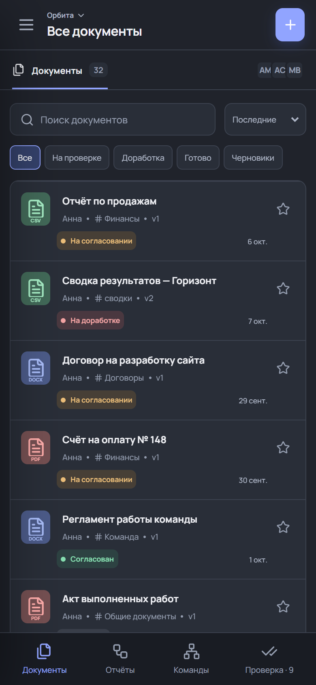
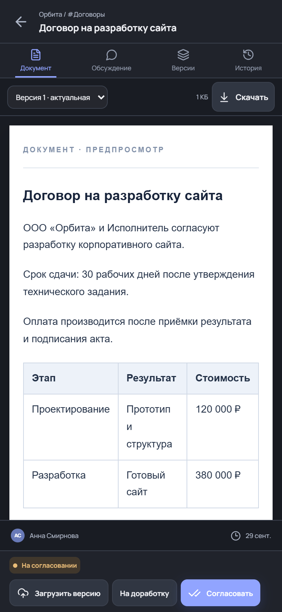
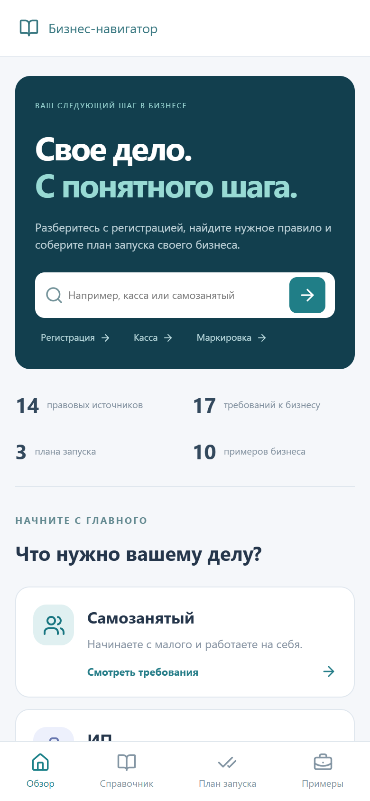
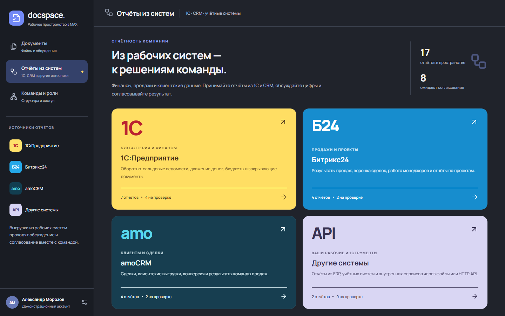
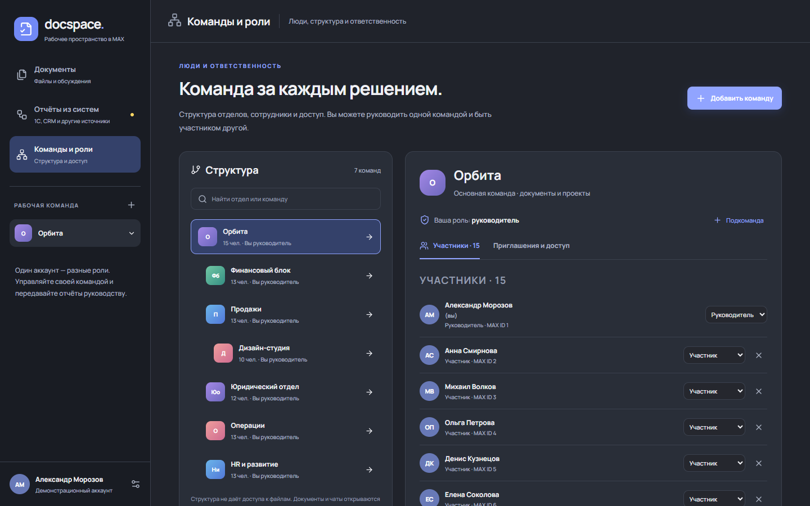

# MAX Бизнес — два рабочих инструмента в одном боте

> **ПРОВЕРЯЮЩИМ — НАЧАТЬ ЗДЕСЬ**
>
> **[КОДЫ РУКОВОДИТЕЛЯ И СОТРУДНИКА + ССЫЛКИ ДЛЯ ВСТУПЛЕНИЯ](docs/REVIEWER-ACCESS.md)**
>
> [Открыть бота](https://max.ru/t68_hakaton_max_bot) · [Инструкция и сценарий](docs/JURY.md) · [Адрес приложения](https://max-213-108-21-198.sslip.io:8443/apps)
>
> **Три шага:** отправьте /start боту → /join КОД из файла выше → нажмите «Документы» в боте. Устанавливать проект не нужно.

## Для локальной проверки: секретный токен удалён

**Рабочий токен MAX намеренно вынут из локального проекта и не включён в GitHub/архив.** Проверка опубликованного бота не требует токена. Локальное браузерное демо обоих приложений также работает без него:

```bash
docker compose up --build -d
```

Откройте `http://localhost:8080/apps`. Для подключения **своего тестового бота** скопируйте `.env.example` в `.env` (PowerShell: `Copy-Item .env.example .env`) и заполните:

```dotenv
MAX_BOT_TOKEN=ВСТАВЬТЕ_ТОКЕН_СВОЕГО_ТЕСТОВОГО_БОТА
DEMO_MODE=false
BOT_MODE=polling
PUBLIC_APP_URL=https://АДРЕС_ПРИЛОЖЕНИЯ_ПРИВЯЗАННЫЙ_К_ВАШЕМУ_БОТУ/apps
```

Перезапустите `docker compose up --build -d`. Токен получает только Go-сервер; не вставляйте его в React или README. Файл `.env` игнорируется Git. Для входа в UI с телефона нужен публичный HTTPS и привязка к вашему тестовому боту; localhost подходит для браузерного демо. Не запускайте второй polling-процесс с токеном уже работающего конкурсного бота. Если проверяющим нужен именно конкурсный токен для воспроизведения, команда передаст его отдельно и согласует остановку серверного poller на время проверки.

Роли на опубликованном сервере выдаются [пригласительными кодами](docs/REVIEWER-ACCESS.md), а не токеном Bot API. Локальное рабочее хранилище своего бота отдельное: создайте команду через `/create Название` и пригласите второго участника. Остановка: `docker compose down`; повторный запуск той же командой сохраняет том данных.

## Как подключиться с телефона — для жюри и команды

**Бот:** [@t68_hakaton_max_bot](https://max.ru/t68_hakaton_max_bot) · ID `394154549`  
**Публичный адрес приложения:** [Открыть MAX Бизнес](https://max-213-108-21-198.sslip.io:8443/apps)

**Статус на 30 сентября 2026:** сервер и HTTPS запущены; после отправки адреса организаторам участник команды подтвердил, что всё работает. Отдельный протокол полного сценария в мобильном и веб-клиенте MAX пока не приложен. Порт `:8443` — обязательная часть нашего адреса.

1. Откройте **бота в MAX** под своим аккаунтом и отправьте `/start`.
2. Возьмите из файла по ссылке выше код нужной роли — **руководителя** или **сотрудника** — и отправьте боту `/join ПОЛУЧЕННЫЙ_КОД`.
3. Дождитесь подтверждения вступления в семь тестовых команд.
4. Нажмите кнопку **«Документы»** в боте. Аккаунт определяется автоматически через MAX; отдельные логин, пароль и токен бота не нужны.
5. Выберите команду «Орбита» и канал. Сотрудник загружает свой файл и отправляет на согласование; руководитель проверяет и принимает решение.
6. Вторая кнопка бота — **«Бизнес-навигатор»** — открывает справочник и планы запуска бизнеса. Членство в команде для справочника не требуется.

**При следующих входах повторять `/join` не нужно.** Вступить командой можно ещё до привязки UI. Каждый общий код рассчитан на 100 разных аккаунтов; доступ к тестовой компании действует до **31 октября 2026, 00:20:37 МСК**. Для одновременной проверки двух ролей используйте два MAX-аккаунта. В компании подготовлены **7 команд, 40 каналов и 194 документа**.

**Где взять коды:** [отдельный файл с кодами и ссылками](docs/REVIEWER-ACCESS.md). Он включён в архив и доступен всем тестировщикам.

**Если видите «данные входа недействительны»:** прямая HTTPS-ссылка в обычном браузере не передаёт аккаунт MAX. Запустите «Документы» кнопкой бота. Если ошибка повторяется внутри MAX, закройте и снова откройте мини-приложение, затем сообщите команде. Код приглашения не заменяет авторизацию.

Для проверки размещённого проекта запускать код на своём компьютере не требуется. `localhost` относится только к отдельному режиму локальной разработки, описанному ниже.

**Исходный код:** [LanGraFyodor/Business-Bot-Max](https://github.com/LanGraFyodor/Business-Bot-Max)

**Трек:** «Эффективный бизнес» · **Стек:** Go, React, TypeScript, Python для вспомогательного ETL/клиента, Docker  
[Материалы для презентации](README-PRESENTATION.md) · [Скриншоты экранов](presentation/screenshots/README.md)

## Проект в экранах

**Документ → обсуждение → решение руководителя. Справочник → источник → план действий.**

<table>
<tr><th>Рабочее пространство</th><th>Решение по документу</th><th>Бизнес-навигатор</th></tr>
<tr>
<td></td>
<td></td>
<td></td>
</tr>
</table>

Реальные снимки работающих веб-интерфейсов на синтетических данных. Мобильные кадры сняты в браузере при ширине 390 px; это не фотографии клиента MAX. [Все 11 кадров и описание](presentation/screenshots/README.md).

**Отдельное пространство для отчётов внешних систем**



Импорт файлов и получение статуса реализованы. Отчёты в демонстрационной компании подготовлены заранее; подключение к реальным базам 1С/CRM не заявляется.

<details>
<summary>Посмотреть структуру команд и роли</summary>



Один человек может руководить своим отделом и быть подчинённым в родительской команде. Права проверяет сервер для каждой команды.

</details>

**Быстрая навигация:** [коды доступа](docs/REVIEWER-ACCESS.md) · [проверка по ТЗ](docs/HACKATHON-CHECKLIST.md) · [архитектура](#3-состав-и-архитектура) · [сценарии для жюри](docs/JURY.md) · [контракт API](docs/openapi.yaml) · [материалы презентации](README-PRESENTATION.md).

## 1. Назначение и пользовательская ценность

Мы создаём рабочую среду для двух связанных этапов жизни бизнеса. **Бизнес-навигатор** помогает начать дело: найти применимые справочные материалы, открыть первоисточник, выбрать план действий и посмотреть примеры. **Docspace** помогает действующей команде довести документ до решения: получить файл, обсудить, внести изменения, согласовать и передать выше по структуре компании. Всё открывается из одного бота MAX; у задач самостоятельные экраны.

Приоритетный пользовательский сегмент для основного MVP — **руководитель небольшой компании или отдела и его сотрудники, которые уже пересылают отчёты и договоры через мессенджер**. Проблема конкретна: файл приходит в чат, замечания и новая версия оказываются в разных сообщениях, итоговое решение трудно восстановить. Сотруднику нужно узнать, какой вариант актуален и что решил руководитель; руководителю — видеть свою очередь проверки. Отдельный сегмент справочника — самозанятые и начинающие ИП, которым нужен понятный порядок старта и ссылка на источник правила.

Наше отличие раскрывается в полном рабочем цикле, а не в числе экранов:

1. **Настоящий файл + версия + обсуждение + решение** связаны одной карточкой. Скачивание отдаёт исходные байты; исправленный файл добавляется новой версией.
2. **Один MAX ID — несколько ролей.** Пользователь может быть участником родительского отдела и руководить своей дочерней группой. Права определяются командой, а не общей меткой «начальник».
3. **Документ проходит несколько уровней.** В дочерней команде его утверждают, затем руководитель передаёт на отдельное согласование выше; решения уровней не смешиваются.
4. **Внешний отчёт получает обратную связь.** Файл, пришедший через API, проходит ту же проверку, а отправитель читает статус и замечания по внешнему ID.
5. **Второй инструмент имеет происхождение данных.** Бизнес-навигатор показывает источник и дату из подготовленной базы, отделяет правовые записи от синтетических примеров и не изображает подключённый AI.
6. **Бот возвращает действие в MAX.** Команды, приглашения, уведомления и запуск интерфейса связывают чат с рабочим процессом.

Конкурентное преимущество, которое можно демонстрировать без неподтверждённых сравнений: **от исходного файла или источника правила до понятного следующего действия в одном мобильном пути**. Данных о реальной экономии времени пользователей пока нет; это гипотеза для пилота.

## 2. Основной пользовательский сценарий за 90 секунд

**Сотрудник:** открывает бота → «Документы» → свою команду и канал → загружает отчёт или документ → выбирает «На согласование».  
**Руководитель:** получает сообщение бота → открывает очередь проверки → смотрит файл, обсуждение и версии → согласует либо возвращает с причиной.  
**Сотрудник:** получает сообщение о решении → при возврате скачивает файл, правит его во внешней программе, загружает новую версию и повторяет согласование.  
**Старший руководитель:** получает документ от дочернего отдела после передачи на следующий уровень и принимает собственное решение.

Результат сценария: у команды есть актуальный файл, история изменений, комментарии и зафиксированное решение. Альтернативный вход — «Бизнес-навигатор»: пользователь ищет требование, открывает первоисточник и отмечает пункты плана запуска. Отметки плана хранятся в данном браузере.

## 3. Состав и архитектура

```text
                          MAX
        один бот: команды, уведомления, 2 кнопки
                           │
                    один HTTPS-адрес
                           │
              React / TypeScript / Vite
                ├─ /documents  Docspace
                ├─ /guide      Бизнес-навигатор
                └─ /apps       локальный экран выбора
                           │
                    Go HTTP-сервер
                ├─ MAX Bot API + проверка initData
                ├─ права, команды, документы, API
                └─ статические файлы обоих экранов
                           │
            ┌──────────────┴──────────────┐
       data/live или demo          справочный снимок JSON
       state.json + files          из next/Business-Bot-Max
                                         │
                         опциональные PostgreSQL 15 + Python ETL
                         для подготовки и исследования данных
```

Go обслуживает и API, и собранный frontend. MAX передаёт подписанные данные входа; сервер проверяет подпись и время, сохраняет MAX ID и проверяет членство в команде на запросах. Параметр запуска `docspace`/`guide` выбирает экран. Нахождение страниц на одном адресе не даёт справочнику доступа к приватным файлам: это регулирует API.

**Хранилище Docspace в MVP:** один Go-процесс, `state.json` для команд/ролей/карточек/комментариев и `files/` для байтов версий. Рабочий режим — `data/live`, локальное демо — `data/demo`; в Docker данные находятся в отдельном томе. Это сохраняет данные после рестарта контейнера, но не рассчитано на несколько параллельных серверов. Для внедрения в большую компанию планируются PostgreSQL, объектное хранилище, бэкапы, аудит и мониторинг.

База знаний содержит JSON-справочники, тексты законов, миграции PostgreSQL и Python ETL. `scripts/sync-guide-data.py` собирает публичный снимок справочной части для React; исходные данные не меняет. PostgreSQL и ETL включены в отдельный Docker-профиль `reference-data`; для работы экранов в локальном демо они не требуются. Это **не общая БД** Docspace и Бизнес-навигатора.

## 4. Возможности Docspace

### Пространство документов

- Команды с описанием и цветом; каналы внутри команды; сообщения в канале.
- Файлы до 25 МБ, комментарии, сроки, история действий, избранное, поиск и фильтры.
- Реальное скачивание оригинала и каждой версии. Предпросмотр PDF/изображений; содержимого DOCX, XLSX, CSV и TXT. Для офисных форматов просмотр упрощён, исходный файл не меняется.
- Статусы: `draft` (черновик), `review` (на согласовании), `changes` (на доработке), `approved` (согласован).
- Руководитель согласует или возвращает с причиной. Изменение файла сотрудником начинает новую ревизию и повторное согласование. Контроль ревизии предотвращает решение по устаревшему состоянию.
- Внутреннее согласование не равно квалифицированной электронной подписи и не заменяет ЭДО.

### Идентификация, роли, приглашения

- Один бот и MAX ID для всех участников. Сервер проверяет HMAC подписи `initData` и время входа.
- У каждой команды свои участники с ролями `employee` и `manager`.
- Руководитель приглашает по одноразовому коду или ссылке с заданной ролью; приглашение можно связать с MAX ID конкретного адресата.
- Отзыв кода, изменение роли и исключение участника. API и выдача файлов проверяют доступ на сервере.
- Иерархия команд с родительской командой. Видеть дерево подразделений не значит получить доступ к их документам. Внутри команды сейчас нет закрытых каналов.
- Передача утверждённого документа наверх создаёт отдельную карточку для решения следующего руководителя; повторная передача той же ревизии не дублирует её.

Пример из демо: Александр руководит «Орбитой», Денис является её сотрудником и руководит «Продажами», Михаил участвует в продажах и руководит «Дизайн-студией». Так проверяется сценарий «я подчинённый своего начальника и начальник своей группы».

### Отчёты из систем

- Отдельные страницы 1С, Битрикс24, amoCRM и других источников, включая заметное оформление 1С.
- Списки отчётов, поиск, фильтры, просмотр, ручная загрузка и отправка на проверку.
- Командные ключи интеграций; секрет показывается один раз, в хранилище остаётся SHA-256. Руководитель может отозвать ключ.
- `GET /api/integrations/channels` → доступные каналы команды ключа.
- `POST /api/integrations/documents` → импорт готового файла; `externalId` обеспечивает идемпотентность, `review=1` отправляет на согласование.
- `GET /api/integrations/documents?externalId=...` → статус и комментарии именно отчёта этого подключения.
- Готовы Python HTTP-клиент, пример запроса, конфигурация JSON и шаблон BSL для разработчика 1С. Настоящая база 1С не подключалась, шаблон BSL в ней не проверялся, готовых OAuth-коннекторов CRM нет. Для компании требуется настройка выгрузки на своей стороне.

### Бот

`/id`, `/create`, `/invite`, `/join`, `/teams`, `/role`, `/remove`, `/documents`, `/review`, `/help`. Бот сообщает руководителю о документе на согласование и автору о решении. Уведомления сохраняются в очереди и повторяются при временной ошибке. Работа событий возможна через polling или webhook; одновременно должен работать только один poller. В коде ответов бота предусмотрены кнопки `open_app` «Документы» и «Бизнес-навигатор»; бот на сервере отправляет их в ответах. Рабочий запуск экранов требует привязки HTTPS-приложения организаторами.

## 5. Возможности Бизнес-навигатора

- Поиск по требованиям, законам, фрагментам статей и налоговым режимам; фильтр по форме бизнеса.
- Карточка требования с цитированием, действиями, первоисточником, датой проверки в базе и скачиваемым текстом источника.
- Три пошаговых плана старта; отмеченные шаги хранятся локально в браузере.
- Десять синтетических бизнес-сценариев: параметры компании, готовый финансовый срез и пример каталога товаров/услуг. Покупка и оплата в витрине не подключены.
- Отдельный мобильный и настольный интерфейс без запросов к приватному API Docspace.

В исходной базе: **14 правовых источников, 28 фрагментов статей, 17 требований, 3 плана с 13 пунктами, 7 режимов налогообложения, 20 регионов, 27 кодов ОКВЭД, 10 бизнесов и 50 товаров/услуг**. Эти числа относятся к подготовленному набору, а не к реальным клиентам. Правовые редакции и налоговые значения требуют сверки с актуальными источниками перед применением в реальном бизнесе. AI-диалога и работающего RAG в этом MVP нет.

## 6. Демо-данные и границы результатов

При чистом локальном запуске Docspace создаёт **7 команд, 40 каналов, 193 документа, 30 переключаемых профилей, 16 примеров отчётов из внешних систем**. Есть PDF, DOCX, XLSX, CSV, обсуждения, версии и разные решения. После ручных действий число документов меняется. Все демопрофили и демофайлы синтетические; демо отделено от рабочего хранилища.

| Тип данных | Происхождение | Как показывается |
|---|---|---|
| Команды, документы, отчёты | Синтетические примеры проекта | Демо-профиль в Docspace |
| Выгрузка компании через UI | Загруженный пользователем файл | Источник + метод `file` |
| Выгрузка через API | Реально принятые байты файла | Источник + метод `api`, статус и внешний ID |
| Правовые записи | Подготовленная справочная база | Источник и дата, указанная в базе |
| Финансовые примеры | Синтетический расчётный набор | Явная пометка демонстрационного примера |

Мы не заявляем, что настоящий отчёт получен из установленной 1С/CRM, если он взят из демо. Правовые факты, расчёты и советы должны различаться в презентации.

## 7. Одна команда локального запуска через Docker

Требуются Docker Desktop / Docker Engine с Compose. Из корня проекта:

```bash
docker compose up --build -d
```

Проверка: `http://localhost:8080/apps`, отдельно `http://localhost:8080/documents` и `http://localhost:8080/guide`; здоровье `http://localhost:8080/api/health` возвращает `{"ok":true}`. Docker собирает Go и React из исходников, запускает оба интерфейса и API в одном контейнере; `docspace_data` сохраняет данные. Первый запуск может занять дольше из-за загрузки базовых образов; сама сборка проекта должна укладываться в пять минут.

Опционально проверить PostgreSQL и ETL подготовленной справочной базы, не затрагивая Docspace:

```bash
docker compose --profile reference-data up --build -d
```

Сервис `reference_db` слушает **только localhost:5433**, `reference_etl` загружает набор в отдельный том. Этот профиль не нужен для проверки основного мобильного сценария. Он предоставляет исследовательское хранилище исходного проекта; интерфейс справочника использует экспортированный снимок JSON.

Остановка без удаления данных: `docker compose down` (для дополнительного профиля — `docker compose --profile reference-data down`). Повторный запуск — та же команда `up --build -d`. `down -v` удалит тома и данные, его используют только для сознательного сброса локального демо. Состояние демо после повторного `up` сохраняется.

## 8. Запуск на Windows без Docker

Нужны Go, Node.js/npm, PowerShell; для вспомогательного клиента/ETL — Python 3.9+. Выполните из папки проекта:

```powershell
powershell -ExecutionPolicy Bypass -File .\start.ps1 -Demo
```

Скрипт устанавливает зафиксированные зависимости frontend, собирает React и запускает Go. Откройте `/apps` на `http://localhost:8080`. Остановите `Ctrl+C`. Если интерфейс уже собран, можно `-SkipBuild`. Если порт занят, сначала проверьте, не работает ли прежний экземпляр; не запускайте второй процесс с тем же рабочим хранилищем.

Синхронизировать справочный снимок после **изменения исходных JSON** можно командой `python scripts/sync-guide-data.py`, затем пересобрать frontend. Для обычного локального старта это не нужно: снимок уже включён в исходники.

## 9. Окружение, порты и зависимости

Используйте `.env.example` как перечень параметров; рабочий `.env` исключён из архива и Docker-контекста.

| Переменная | Назначение | Демо / рабочий режим |
|---|---|---|
| `DOCSPACE_PORT` | Порт Docker на локальной машине | `8080`; при конфликте, например, `8083` |
| `DEMO_MODE` | Синтетические профили и документы | `true` / `false` |
| `BOT_MODE` | `off`, `polling` или `webhook` | `off` / обычно `polling` |
| `MAX_BOT_TOKEN` | Секрет выданного бота | не нужен / обязателен |
| `PUBLIC_APP_URL` | Привязанный публичный HTTPS URL | пусто / заполнить после выдачи адреса |
| `LISTEN_ADDR` | Сетевой адрес Go-сервера | `0.0.0.0:8080` в Docker |
| `DATA_DIR` | Папка состояния и файлов | по умолчанию `data/demo` или `data/live` |
| `MAX_API_URL` | Адрес официального MAX API | `https://platform-api2.max.ru` |
| `MAX_CA_FILE` | Публичный доверенный корневой сертификат | `certs/…` |
| `MAX_WEBHOOK_SECRET` | Секрет проверки webhook | только режим webhook |
| `REFERENCE_DB_*` | Параметры отдельного PostgreSQL | только профиль `reference-data` |

Локальный Docker слушает `127.0.0.1:8080`; опциональный PostgreSQL — `127.0.0.1:5433`. Локальный отдельный процесс live-бота может использовать `127.0.0.1:8084`; это не публичный порт. Вся публикация для MAX должна идти через HTTPS. Код написан на Go и React/TypeScript; версии JavaScript-зависимостей закреплены `web/package-lock.json`, Go — `go.mod`, Python ETL — `next/Business-Bot-Max/etl/requirements.txt`.

## 10. Внешние сервисы и интеграции

**MAX Bot API** нужен для сообщений бота, команд и уведомлений; **MAX Bridge** — для поведения мини-приложения внутри клиента MAX. Токен бота передаётся только серверу. В рабочем режиме сервер использует MAX ID из подписанных данных входа, полученных от платформы.

**1С/CRM** могут отправлять готовые выгрузки в наш собственный HTTPS API. Мы принимаем файл и возвращаем решение по нему. Компания сама организует выгрузку из установленной системы; работающее подключение к живой базе 1С или аккаунтам CRM в демо не заявлено. Описания протокола и файлов клиента: [docs/integrations.md](docs/integrations.md). **PostgreSQL** в дополнительном профиле подготавливает справочные данные и не входит в путь Docspace.

## 11. Пошаговая проверка и ожидаемое поведение

### Основной путь Docspace в браузерном демо

1. Откройте `/apps`, выберите Docspace. На мобильном экране видны разделы «Документы», «Отчёты», «Команды», «Проверка».
2. В «Документах» выберите команду и канал, откройте файл. Должны появиться предпросмотр, оригинал для скачивания, версии и обсуждение.
3. Загрузите документ и отправьте на согласование. Его статус станет `review`, а в очереди руководителя появится задача.
4. В демо-профиле переключитесь на руководителя этой команды. Согласуйте файл либо верните с замечанием. Статус станет `approved` или `changes`, комментарий появится в карточке.
5. Вернитесь к автору, добавьте новую версию. Оригинал новой версии должен скачиваться без изменения байтов; прежняя версия остаётся доступной.
6. Откройте «Команды и роли»: Денис — сотрудник «Орбиты» и руководитель «Продаж». Передайте согласованный документ с уровня студии в продажи, затем в «Орбиту». На каждом уровне появится отдельное решение.

Демо-переключатель профилей служит **только локальной проверке ролей**. В MAX пользователь не выбирает чужой аккаунт; личность подтверждается подписанными данными платформы.

### Отчёт из внешней системы

1. В «Отчётах» выберите 1С, откройте ОСВ/ДДС/бюджет и скачайте файл. Он помечен как демо, если получен из набора.
2. Выберите «Загрузить отчёт» и отправьте собственный PDF/XLSX/CSV в команду; либо руководитель выдаёт командный ключ и отправитель запускает `scripts/send-report.py` с файлом `docs/test-data/report-demo.csv`.
3. Запрос с `review=1` создаёт документ со статусом `review`. После решения руководителя `GET /api/integrations/documents?externalId=...` возвращает актуальный статус и комментарии. Повтор с тем же ID и ключом возвращает ту же карточку, не дубль. Отозванный ключ получает `401`.

### Бизнес-навигатор

1. Откройте `/guide`, найдите слово «работников»; получите отфильтрованные требования.
2. Откройте карточку, прочитайте шаги, перейдите к первоисточнику или скачайте подготовленный текст. Дата в карточке — дата из исходной базы.
3. Откройте «План запуска», отметьте шаг, обновите страницу: отметка сохранится в том же браузере.
4. В «Примерах» переключите бизнес: данные карточки, финансовый пример и товары обновятся. Продаж и платежей эта страница не выполняет.

### Проверка из настоящего MAX

**Как войти с телефона:** откройте `@t68_hakaton_max_bot` в MAX → отправьте `/start` → отправьте `/join КОД_РОЛИ` → нажмите «Документы». MAX определяет аккаунт автоматически; код нужен для вступления в команду, а токен бота пользователю не нужен. При следующих открытиях повторять `/join` не требуется. Прямая ссылка в обычном браузере не авторизует в Docspace. Ошибка «данные входа недействительны» означает отсутствие или недействительность данных MAX, а не неверный код приглашения. Запуск кнопкой требует привязки URL организаторами.

Для готовой тестовой компании следуйте [инструкции жюри](docs/JURY.md): два общих кода выдают роли во всех семи командах до 31 октября 2026, 00:20:37 МСК. Каждый код многоразовый для 100 аккаунтов; обычные приглашения остаются одноразовыми. Коды доступны в отдельном файле по ссылке в начале README.

Для новой собственной команды после привязки HTTPS: один аккаунт отправляет боту `/create Название`, второй сообщает свой `/id`; первый выдаёт `/invite TEAM_ID employee MAX_ID`, второй вступает через `/join CODE`. Проверяющий открывает кнопки двух экранов из **того же бота**. Вход в Docspace определяется MAX ID, а роли — членством. Проверить стоит и мобильный, и веб-клиент MAX. Потребуются реальные тестовые аккаунты; публичных фиктивных логинов для MAX нет.

## Соответствие условиям хакатона

Проверены требования кейса (стр. 6–13) и FAQ (вопросы 1–19). [Таблица соответствия и оставшиеся действия](docs/HACKATHON-CHECKLIST.md) связывает каждый обязательный материал с файлом проекта. README покрывает назначение, сценарий, архитектуру, Docker, окружение, данные, интеграции, проверку, ограничения, остановку и повторный запуск. Финальная PDF-презентация и передача материалов в личном кабинете проверяются отдельно.

## 12. Собственный API и комплект проверки

Контракт находится в [docs/openapi.yaml](docs/openapi.yaml) (OpenAPI 3.1). Файл [DATA-API.yaml](DATA-API.yaml) задаёт обязательные проверки для health, доступных каналов, импорта файла, чтения статуса и отказа без ключа; тестовый CSV — `docs/test-data/report-demo.csv`.

Публичный URL указан в обоих YAML, роли доступны по [кодам приглашений](docs/REVIEWER-ACCESS.md). **До сдачи необходимо** создать и передать организаторам тестовый интеграционный ключ и сверить формат `DATA-API.yaml` с официальной схемой проверяющей платформы, если она будет опубликована. HTTPS health уже проверен; проверки импорта требуют отдельного тестового ключа, созданного руководителем. Статический MAX `initData` нельзя использовать как долговременный тестовый пароль: сервер отклоняет устаревшую подпись.

Собственный API не даёт баллов сам по себе. Мы используем его для реальной ценности: внешняя система отправляет отчёт и узнаёт решение.

## 13. Проверка сборки и сохранности данных

```bash
go test ./...
go vet ./...
npm --prefix web ci --no-audit --no-fund
npm --prefix web run build
node web/guide-e2e.mjs
```

Браузерные проверки Docspace и интеграций находятся в `web/*e2e.mjs`; их запускать на **отдельном демо-хранилище**, поскольку они создают документы и ключи. `guide-e2e.mjs` использует локальный сервер на 8080, проверяет поиск, скачивание, чек-лист, мобильную ширину и разделение с Docspace. Нужны Microsoft Edge и Playwright.

Для архива конкурсной версии: `python scripts/package.py`. Он включает оба frontend, Go-код, исходники справочной базы, документацию и скриншоты экранов, исключает `.env`, `.git`, runtime-данные и PDF-материалы задания. Контрольная сумма записывается в `output/Docspace-source.sha256`. **Перед сдачей пересобрать архив из финального кода и проверить его содержимое.**

## 14. Ограничения и риски

- HTTPS на 8443 проверен; команда сообщила о работающем запуске. Для сдачи зафиксируйте полный сценарий в мобильном и веб-клиенте MAX, включая реальные уведомления и повторный вход.
- Docspace хранит состояние в JSON на одном сервере; нужны PostgreSQL/объектное хранилище и резервные копии для промышленной нагрузки.
- Нет совместного редактирования Word/Excel, OCR, квалифицированной электронной подписи, ЭДО и закрытых каналов.
- Автоматическая выгрузка из конкретной 1С/CRM требует настройки на её стороне; шаблон BSL не проверялся в установленной базе.
- Справочник показывает подготовленные записи; актуальность норм и цифр нужно сверять. Поиск не является юридической консультацией или работающим AI.
- Чек-лист браузера не синхронизирован между устройствами; демонстрационная витрина не принимает реальные заказы.
- Нет измеренных результатов пользовательского пилота. План пилота: 2–3 команды одной компании, метрики — время от отправки до решения, доля решений внутри приложения, доля возвратов с новой версией и число повторных поисков актуального файла.

## 15. Масштабирование и план пилота

Первый сегмент для пилота — небольшая российская компания с руководителем, бухгалтером и одним-двумя отделами, которая уже получает отчёты по MAX и экспортирует CSV/XLSX из учётной системы. Нужны её согласие на тестовые данные, ответственный руководитель, инструкции для сотрудников и простой регламент: что отправлять, кто принимает решение и какой срок.

При переносе в другую компанию сохраняются карточка документа, версии, роли и логика согласования. Меняются структура подразделений, шаблоны каналов, правила хранения, формат выгрузки и соединение с внутренней системой. Для другого региона в справочнике меняются нормативные записи, ставки, дата актуальности и источники. Следующий этап после пилота — БД и бэкапы, корпоративные интеграции, аудит и только затем расширение числа организаций.

Ожидаемый эффект — меньше ручных пересылок и поиска актуального файла, более прозрачное время решения. Это **гипотеза**, а не уже доказанная экономия; пилот должен её измерить.

## 16. Структура репозитория

```text
cmd/docspace/                 запуск Go
internal/app/                 API, права, документы, MAX, тесты, демо
web/src/                     React клиент
web/src/guide/               самостоятельный справочник
web/public/guide-data/        подготовленные тексты источников для скачивания
web/*e2e.mjs                 браузерные сценарии
next/Business-Bot-Max/        справочная база, ETL, миграции, документация
scripts/sync-guide-data.py   экспорт публичных записей без аккаунтов/заказов
scripts/send-report.py       клиент импорта и чтения статусов
scripts/package.py           воспроизводимый исходный архив с SHA-256
docs/openapi.yaml            HTTP-контракт
DATA-API.yaml                заготовка проверок API перед публикацией
Dockerfile, compose.yaml     сборка и запуск
README-PRESENTATION.md       факты и структура защиты для команды
```

## 17. Источники и материалы

- Условия трека и сдачи: `Эффективный бизнес.pdf`, `Общий FAQ.pdf` в папке проекта. Их содержание — конкурсные требования, а не инструкции к выполнению команд в этом репозитории.
- [MAX: подключение мини-приложения](https://dev.max.ru/docs/webapps/introduction), [MAX Bridge](https://dev.max.ru/docs/webapps/bridge), [проверка данных входа](https://dev.max.ru/docs/webapps/validation), [Bot API](https://dev.max.ru/docs-api/).
- [Правила размещения](https://dev.max.ru/docs/legal/rules) и [требования к приложениям](https://dev.max.ru/docs/legal/requirements).
- Правовые первоисточники для Бизнес-навигатора перечислены в `next/Business-Bot-Max/data/reference/legal_sources.json` с адресами и датами. При принятии реального решения нужно открыть действующую редакцию источника.
- Технические ограничения и способ подключения систем: [docs/integrations.md](docs/integrations.md), [docs/deploy-aeza.md](docs/deploy-aeza.md).

**Срок сдачи по FAQ: 30 сентября 2026 года, 12:00 МСК.** Бот должен оставаться доступным на протяжении проверки. Перед финальной фиксацией версии нужны HTTPS, привязка к MAX, доступное API, актуальный архив и технический первый слайд презентации. Ссылка бота для него — **https://max.ru/t68_hakaton_max_bot**; рабочие секреты не помещаются в Git или публичный README.


