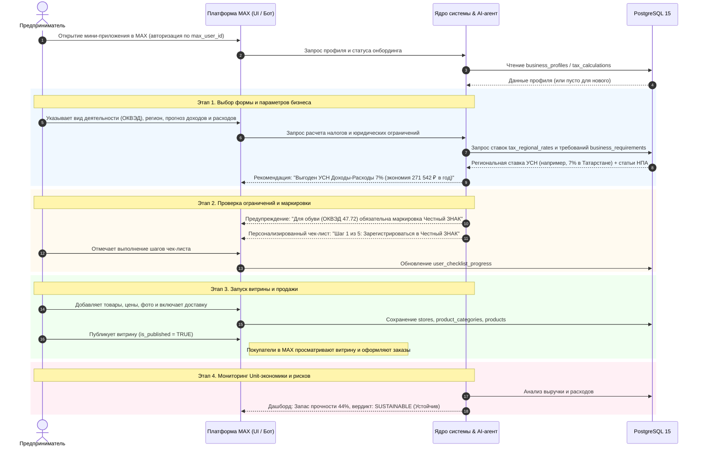
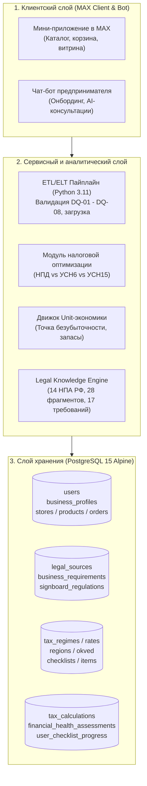

# «Конструктор бизнеса пользователя» в MAX 🚀

> **Хакатон 2026 | Трек «Эффективный бизнес» (Цифровая платформа MAX)**  
> Комплексное решение для малого бизнеса: конструктор e-commerce витрин в мессенджере MAX, интеллектуальный AI-ассистент по налогам и правовым требованиям (RAG), расчетные модели Unit-экономики, идемпотентный ETL-пайплайн и эталонный тестовый датасет.

> 🤖 **Чат-бот в мессенджере MAX:**  
> - **Юзернейм бота:** `@t68_hakaton_max_bot` (ищите в поиске мессенджера MAX через `@t68_hakaton_max_bot` или по названию)  
> - **Имя бота:** `Хакатон МАХ 68`  
> - **ID бота:** `394154549`  
> - **Статус API:** `200 OK` (верифицирован через `GET https://platform-api2.max.ru/me`)

---

## 📋 Оглавление

1. [Назначение решения](#1-назначение-решения)
2. [Основной пользовательский сценарий](#2-основной-пользовательский-сценарий)
3. [Состав и архитектура](#3-состав-и-архитектура)
4. [Запуск из одной строки через Docker](#4-запуск-из-одной-строки-через-docker)
5. [Переменные окружения](#5-переменные-окружения)
6. [Сетевые порты](#6-сетевые-порты)
7. [Системные зависимости](#7-системные-зависимости)
8. [Внешние сервисы и интеграции](#8-внешние-сервисы-и-интеграции)
9. [Описание работы с данными](#9-описание-работы-с-данными)
10. [Порядок работы с тестовыми данными](#10-порядок-работы-с-тестовыми-данными)
11. [Пошаговый сценарий проверки](#11-пошаговый-сценарий-проверки)
12. [Примеры ожидаемого поведения](#12-примеры-ожидаемого-поведения)
13. [Известные ограничения](#13-известные-ограничения)
14. [Порядок остановки и повторного запуска](#14-порядок-остановки-и-повторного-запуска)
15. [Структура детальной документации](#15-структура-детальной-документации)

---

## 1. Назначение решения

Сервис решает проблему высокого порога входа и юридических рисков при открытии и ведении микробизнеса в России (Самозанятые, ИП, ООО). Решение интегрировано в цифровую платформу **мессенджера MAX** и предоставляет:

1. **Конструктор витрин товаров и услуг в MAX:**  
   Позволяет предпринимателю за 3 минуты запустить полноценный интернет-магазин внутри мессенджера (каталог, категории, карточки с фото и ценами, маркировка товаров, условия курьерской доставки и самовывоза, оформление заказов).
2. **Интеллектуальный помощник предпринимателя (AI Business Assistant):**
   - **Налоговая оптимизация 2026:** Автоматическое математическое сравнение режимов (НПД vs УСН «Доходы» 6% vs УСН «Доходы минус Расходы» с учетом региональных льгот в субъектах РФ) и вычет страховых взносов по ст. 346.21 НК РФ.
   - **Правовой навигатор и превентивный контроль:** Проверка обязательной маркировки «Честный ЗНАК» (ОКВЭД 47.71/47.72), кассовой дисциплины (54-ФЗ), правил размещения вывесок и закона о защите прав потребителей.
   - **Диагностика финансовой устойчивости (Unit-экономика):** Расчет точки безубыточности, запаса финансовой прочности и раннее предупреждение рисков кассового разрыва.
   - **Интерактивные чек-листы:** Пошаговые дорожные карты старта бизнеса с привязкой к статьям законов.

---

## 2. Основной пользовательский сценарий

Ниже представлен сквозной путь предпринимателя в системе (Customer Journey):



---

## 3. Состав и архитектура

Архитектура построена на модульном микросервисном принципе с четким разделением слоев:



### Компоненты системы:
1. **База данных PostgreSQL 15 (`db`):** 17 таблиц, 5 доменов данных, полнотекстовые GIN-индексы на русском языке, триггеры автоматического обновления `updated_at`, строгие ограничения уровня БД (`CHECK`).
2. **ETL-контейнер (`etl`):** Легковесный модуль на Python 3.11-slim для извлечения, валидации (правила DQ-01 — DQ-08), идемпотентного применения данных и проведения smoke-тестов целостности.
3. **Хранилище нормативно-правовых знаний:** 14 федеральных законов и постановлений Правительства РФ, сохраненных в кодировке UTF-8 с контрольными суммами SHA-256 в `data/raw/laws/`.
4. **Справочники НСИ:** 12 файлов JSON (`data/reference/`) с тарифами, ставками субъектов РФ, кодами классификаторов и типовыми задачами.
5. **Синтетический генератор:** Детерминированный генератор эталонных сценариев бизнеса с поддержкой воспроизводимости по `seed`.

---

## 4. Запуск из одной строки через Docker

Для запуска всей инфраструктуры, автоматического применения миграций и валидации данных достаточно одной команды в терминале:

```bash
docker compose up -d db && docker compose run --rm etl
```

### Что происходит при выполнении:
1. Поднимается контейнер СУБД `max_business_db` на базе PostgreSQL 15 Alpine.
2. PostgreSQL инициализирует структуру БД и автоматически в алфавитном порядке накатывает миграции из папки `data/migrations/`:
   - `01_init_schema.sql` — создание 17 таблиц, индексов, триггеров и констрейнтов.
   - `02_seed_legal_data.sql` — загрузка 14 законов, 28 фрагментов и 17 требований.
   - `03_seed_reference_data.sql` — загрузка налоговых ставок субъектов РФ, ОКВЭД, регионов и чек-листов.
   - `04_seed_test_dataset.sql` — наполнение 10 эталонными профилями, витринами, товарами и расчетами.
3. Запускается сервис `max_business_etl`, который проводит валидацию бизнес-правил DQ-01 — DQ-08, подтверждает целостность связей и выводит итоговую сводную таблицу в консоль.

---

## 5. Переменные окружения

Конфигурация проекта управляется через переменные окружения в файле `.env` (шаблон: [`.env.example`](file:///d:/Hackaton/MAX/.env.example)):

| Переменная | Значение по умолчанию | Описание и назначение |
|---|---|---|
| `POSTGRES_DB` | `max_business` | Имя базы данных PostgreSQL. |
| `POSTGRES_USER` | `postgres` | Имя пользователя суперпользователя СУБД. |
| `POSTGRES_PASSWORD` | `postgres_secret_password` | Пароль доступа к базе данных. |
| `POSTGRES_PORT` | `5432` | Внешний TCP-порт для подключения к PostgreSQL с хоста. |
| `DATABASE_URL` | `postgresql://postgres:postgres_secret_password@db:5432/max_business` | Строка подключения к СУБД для сервисов и ETL-пайплайна. |
| `MAX_BOT_TOKEN` | `your_bot_token_here` | Токен авторизации бота в мессенджере MAX (выдается платформой). |
| `MAX_API_BASE_URL` | `https://platform-api2.max.ru` | Базовый URL API платформы MAX. |

> [!NOTE]
> В исходном коде и репозитории отсутствуют захардкоженные пароли и реальные секретные токены. Все чувствительные параметры изолированы в файле `.env`.

---

## 6. Сетевые порты

| Сервис | Порт внутри сети Docker | Внешний порт на хосте | Протокол | Назначение |
|---|---|---|---|---|
| **PostgreSQL (`db`)** | `5432` | `5432` (настраивается в `.env`) | TCP | Доступ к базе данных из DBeaver, psql, бекенда или внешних систем. |
| **ETL (`etl`)** | — | — | — | Однократный процесс (run-to-completion), порты наружу не публикует. |

---

## 7. Системные зависимости

### Минимальные требования:
- **ОС:** Windows 10/11, macOS, Linux.
- **Docker:** Версия 24.0+ или Docker Desktop с установленным Compose v2.
- **Свободная оперативная память:** не менее 2 ГБ.
- **Свободное место на диске:** не менее 3 ГБ.

### Стек технологий:
- **СУБД:** PostgreSQL 15-alpine.
- **Среда выполнения ETL:** Python 3.11-slim (`psycopg2-binary >= 2.9.9`).
- **Скрипты генерации:** Python 3 standard library / PowerShell 5.1+.

---

## 8. Внешние сервисы и интеграции

Система разделяет реальные интеграции и демонстрационные моки согласно требованиям хакатона:

| Сервис / Интеграция | Тип интеграции | Статус в проекте | Назначение |
|---|---|---|---|
| **Платформа мессенджера MAX** | Внешний REST API / Webhooks | Реализовано в модели данных | Авторизация по `max_user_id`, отправка уведомлений, запуск Web-витрин. |
| **Официальный портал правовой информации `pravo.gov.ru`** | Источник нормативных актов | Фактические данные (SHA-256) | Первоисточник 14 федеральных законов РФ. |
| **ФНС России (`nalog.gov.ru`)** | Реестры и налоги | Фактические данные | Ставки УСН, НПД, правила вычета фиксированных взносов по ст. 430 НК РФ. |
| **ГИС МТ «Честный ЗНАК» (`crpt.ru`)** | Система цифровой маркировки | Проверка правил (DQ-06) | Автоматический контроль обязательности Data Matrix для одежды и обуви. |
| **Согласование вывесок (Комитеты архитектуры)** | Муниципальная услуга | Модельные данные (`is_mocked_data = TRUE`) | Имитация проверки предельных габаритов вывесок и перечня документов (ПП № 902-ПП). |
| **Платежный шлюз (СБП / Эквайринг)** | Финтех-сервис | Безопасная модель | Проведение оплат без сохранения карточных данных (152-ФЗ Zero PII). |

---

## 9. Описание работы с данными

Подробное руководство по управлению данными изложено в [**DATA_DOCUMENTATION.md**](file:///d:/Hackaton/MAX/docs/DATA_DOCUMENTATION.md).

### 9.1. Таксономия данных (Критерий кейса)
- **Факты:** Законы РФ (422-ФЗ, 54-ФЗ, 152-ФЗ и др.), официальные ставки, справочники ОКВЭД 2.
- **Расчеты:** Налоговые калькуляции, суммы взносов ИП (53 658 руб. за 2026 год), расчет маржинальности и точки безубыточности.
- **Рекомендации:** Юридические оговорки (*«Расчет носит предварительный характер»*), советы AI-ассистента по снижению расходов.
- **Моделированные данные:** Тестовые профили, моки регламентов вывесок с признаком `is_mocked_data = TRUE`.

### 9.2. Политика Zero PII (152-ФЗ)
- **Полный отказ от избыточных персональных данных:** В базе данных **не хранятся** паспортные данные, номера банковских карт, СНИЛС и биометрия.
- **Идентификация:** Все пользователи и покупатели идентифицируются через строковый идентификатор `max_user_id`.

### 9.3. Матрица качества данных (Data Quality Rules)
В ETL и на уровне схемы БД реализовано 8 строгих правил:
- **DQ-01:** Лимит дохода самозанятого: `monthly_revenue_est * 12 <= 2 400 000 руб.` (ст. 4 422-ФЗ).
- **DQ-02:** Запрет сотрудников для НПД: `has_employees = FALSE` и `employee_count = 0`.
- **DQ-03:** Неотрицательность финансовых величин: выручка, расходы, цены, остатки $\ge 0$.
- **DQ-04:** Валидация формата ИНН (10 цифр для ООО, 12 для ИП, `NULL` для НПД).
- **DQ-05:** Проверка существования кода региона в справочнике субъектов РФ.
- **DQ-06:** Автоматический контроль обязательной маркировки «Честный ЗНАК» для обуви и одежды.
- **DQ-07:** Полная идемпотентность загрузки (`ON CONFLICT DO UPDATE`).
- **DQ-08:** Целостность внешних связей (`CASCADE` для зависимых, `SET NULL` для ссылочных записей).

---

## 10. Порядок работы с тестовыми данными

Подробное описание сценариев представлено в [**TEST_DATA.md**](file:///d:/Hackaton/MAX/docs/TEST_DATA.md).

### 10.1. Состав 10 эталонных сценариев:
1. **Кондитерская «Сладкий Лис» (Самозанятый, Москва):** НПД 4%, бенто-торты, 0 сотрудников.
2. **IT-разработка «KazanCode» (Самозанятый, Казань):** НПД 4%, чат-боты и мини-аппы для MAX.
3. **Студия «Easy English» (Самозанятый, СПб):** НПД 4%, индивидуальные уроки и абонементы.
4. **Бренд одежды «Север» (ИП, Казань):** УСН Д-Р 7%, 2 сотрудника, **маркировка «Честный ЗНАК»**.
5. **Магазин «StepForward» (ИП, Екатеринбург):** УСН Д-Р 7%, 3 сотрудника, **маркировка обуви Data Matrix**.
6. **Агентство «Focus Media» (ИП, Москва):** УСН Доходы 6%, 4 сотрудника, вычет страховых взносов ограничен 50%.
7. **Кофейня «Зерно & Толк» (ООО, Казань):** УСН Д-Р 7%, 5 сотрудников, умеренный риск (`AT_RISK`), вывеска.
8. **«Хлебная Мануфактура» (ООО, Москва):** УСН Д-Р 10%, 8 сотрудников, устойчивый бизнес (`SUSTAINABLE`).
9. **[EDGE CASE 1: Порог НПД] Студия «Zaripova Design» (Самозанятый, Казань):**  
   Доход 195 000 ₽/мес (годовой 2.34 млн ₽ = **97.5% от лимита 2.4 млн ₽**). Предупреждение о скорой утрате права на НПД и алгоритм перехода на ИП.
10. **[EDGE CASE 2: Кассовый разрыв / Убыток] Сувениры «Подарки Казани» (ИП, Казань):**  
    Выручка 180 000 ₽ < Расходы 240 000 ₽ (**чистый убыток -60 000 ₽/мес**, вердикт `CRITICAL`, отрицательный запас прочности -125%).

### 10.2. Перегенерация данных с произвольным Seed:
```bash
# Генерация с фиксированным seed=42
python -m etl.generators.test_data_generator --seed 42
```

---

## 11. Пошаговый сценарий проверки

Для полной проверки решения жюри или разработчиком выполните следующие шаги:

### Шаг 1: Подготовка и запуск
```bash
cp .env.example .env
docker compose up -d db && docker compose run --rm etl
```

### Шаг 2: Проверка логов ETL
Убедитесь, что в консоли отобразилась сводная таблица со всеми статусами `OK`:
- Справочники: 12 файлов загружено без ошибок.
- Законы: 14 НПА и 17 требований загружено.
- Тестовый датасет: 10 профилей, 10 витрин, 50 товаров, 10 расчетов налогов, 10 оценок здоровья.

### Шаг 3: Проверка данных через DBeaver / psql
Подключитесь к базе данных:
- **Хост:** `localhost`, **Порт:** `5432`, **БД:** `max_business`, **Пользователь:** `postgres`, **Пароль:** `postgres_secret_password`.

Выполните проверочный запрос для оценки налоговой оптимизации и устойчивости:
```sql
SELECT 
    bp.business_name,
    bp.legal_form,
    tc.recommended_regime_code AS optimal_tax,
    fha.monthly_revenue,
    fha.net_monthly_profit,
    fha.break_even_point,
    fha.safety_margin_percent,
    fha.cash_gap_risk_level,
    fha.verdict
FROM business_profiles bp
JOIN tax_calculations tc ON tc.business_profile_id = bp.id
JOIN financial_health_assessments fha ON fha.business_profile_id = bp.id
ORDER BY fha.safety_margin_percent ASC;
```

---

## 12. Примеры ожидаемого поведения

### Пример 1. Ожидаемый вывод ETL-пайплайна в терминале
```text
========================================================================================
СВОДНЫЙ ОТЧЕТ ВЫПОЛНЕНИЯ ETL-ПАЙПЛАЙНА
========================================================================================
Сущность                         Прочитано  Валидно  Вставлено  Обновлено  Ошибки Статус
----------------------------------------------------------------------------------------
legal_sources                           14       14         14         14       0     OK
business_requirements                   17       17         17         17       0     OK
tax_regimes                              7        7          7          7       0     OK
tax_regional_rates                       8        8          8          8       0     OK
regions                                 20       20         20         20       0     OK
okved                                   27       27         27         27       0     OK
users                                   10       10         10         10       0     OK
business_profiles                       10       10         10         10       0     OK
stores                                  10       10         10         10       0     OK
products                                50       50         50         50       0     OK
tax_calculations                        10       10         10         10       0     OK
financial_health                        10       10         10         10       0     OK
----------------------------------------------------------------------------------------
ИТОГО                                  224      224        224        224       0     OK
========================================================================================
[SUCCESS] ETL-пайплайн успешно завершен! Все данные консистентны.
```

### Пример 2. Ожидаемый результат SQL-запроса по финансовому здоровью
Для краевых сценариев запрос возвращает:
- `Zaripova Design`: `verdict = SUSTAINABLE`, рекомендация: *«ВНИМАНИЕ: Годовой доход приближается к 2.4 млн руб. (порог 97.5%). Подготовьте документы для перехода на ИП на УСН 6%»*.
- `Подарки Казани`: `monthly_revenue = 180000`, `net_monthly_profit = -60000`, `safety_margin_percent = -125.00%`, `cash_gap_risk_level = HIGH`, `verdict = CRITICAL`.

---

## 13. Известные ограничения

В рамках реализации MVP на онлайн-этапе хакатона зафиксированы следующие допущения:
1. **Муниципальные регламенты вывесок:** Процедура согласования в Комитете архитектуры имитируется на базе Постановления Правительства Москвы № 902-ПП и помечена флагом `is_mocked_data = TRUE`.
2. **Экстраполяция дохода НПД:** Проверка годового лимита 2.4 млн руб. рассчитывается как среднемесячный доход $\times 12$.
3. **Региональные ставки УСН:** В справочнике детализированы 20 ключевых субъектов РФ; для остальных регионов применяется базовая федеральная ставка (6% для «Доходов» и 15% для «Доходов минус Расходов»).
4. **Внешние API ФНС и Честный ЗНАК:** Прямая интеграция через защищенный контур СМЭВ/API ФНС не используется; реализован превентивный валидатор на основе официальных правил и справочников.

---

## 14. Порядок остановки и повторного запуска

### Обычная остановка контейнеров (данные сохраняются):
```bash
docker compose down
```

### Повторный запуск:
```bash
docker compose up -d db
```

### Полный сброс базы данных и повторная инициализация с нуля:
```bash
# Удаление контейнеров и именованного тома данных pgdata
docker compose down -v

# Чистый запуск и повторный прогон пайплайна
docker compose up -d db && docker compose run --rm etl
```

---

## 15. Структура детальной документации

| Документ | Назначение и ключевые темы |
|---|---|
| 📋 [**DATA_REQUIREMENTS.md**](file:///d:/Hackaton/MAX/docs/DATA_REQUIREMENTS.md) | Бизнес-требования к данным, таксономия (Факты / Расчеты / Советы / Модели), матрица масштабирования. |
| 📚 [**DATA_DOCUMENTATION.md**](file:///d:/Hackaton/MAX/docs/DATA_DOCUMENTATION.md) | **Полный каталог данных и Data Governance:** подробный словарь всех 17 таблиц, Data Lineage, реестр Zero PII, матрица DQ-01 — DQ-08. |
| 🗄️ [**DATABASE_MODEL.md**](file:///d:/Hackaton/MAX/docs/DATABASE_MODEL.md) | Реляционная схема PostgreSQL (Mermaid ERD, 5 доменов), полнотекстовые индексы GIN, CHECK-констрейнты, триггеры `updated_at`. |
| ⚖️ [**LEGAL_CHECKLIST.md**](file:///d:/Hackaton/MAX/docs/LEGAL_CHECKLIST.md) | Реестр 14 НПА РФ (422-ФЗ, 54-ФЗ, 152-ФЗ, НК РФ 26.2, ЗоЗПП и др.), 28 фрагментов статей и 17 требований с санкциями. |
| 📜 [**LAWS_PROCESSING_REPORT.md**](file:///d:/Hackaton/MAX/docs/LAWS_PROCESSING_REPORT.md) | Отчет об обработке законов (конвертация CP1251 $\rightarrow$ UTF-8, контрольные суммы SHA-256, метаданные). |
| 📖 [**REFERENCE_DATA.md**](file:///d:/Hackaton/MAX/docs/REFERENCE_DATA.md) | Справочники НСИ: 7 систем налогообложения, региональные ставки, 27 кодов ОКВЭД, 20 регионов, чек-листы. |
| 🔄 [**ETL_PIPELINE.md**](file:///d:/Hackaton/MAX/docs/ETL_PIPELINE.md) | Архитектура и запуск ELT/ETL-пайплайна: идемпотентность, цветное логирование, сводная таблица, нефатальная обработка ошибок. |
| 🧪 [**TEST_DATA.md**](file:///d:/Hackaton/MAX/docs/TEST_DATA.md) | Описание эталонного тестового набора данных: 10 сценариев бизнеса, краевые случаи, готовые SQL-запросы для DBeaver. |
| 📊 [**PRESENTATION_BRIEF.md**](file:///d:/Hackaton/MAX/docs/PRESENTATION_BRIEF.md) | **Материалы для презентации:** тезисы питча, целевые аудитории, расчет налога, алгоритм генерации требований, Unit-экономика и масштабирование. |

