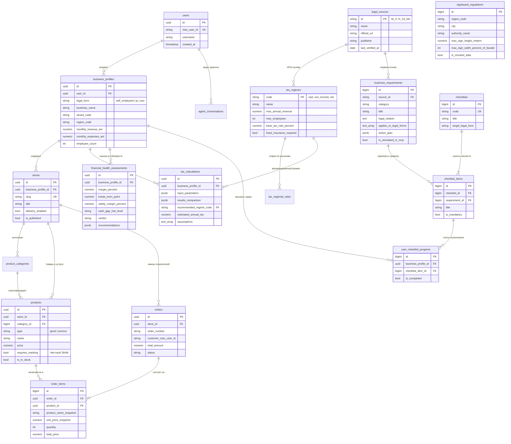

# Архитектурная модель данных (PostgreSQL Database Model)

Реляционная модель данных для сервиса «Конструктор бизнеса и агенты-помощники в MAX».

СУБД: PostgreSQL 15+  
Версия схемы: 1.0  
Файл миграции: [data/migrations/01_init_schema.sql](file:///d:/Hackaton/MAX/data/migrations/01_init_schema.sql)

---

## 1. Архитектурные принципы

Схема базы данных построена на четырех правилах:

1. Обезличенная идентификация по 152-ФЗ. В таблицах хранятся только технические идентификаторы пользователей мессенджера MAX (max_user_id). Паспортные данные, пароли, СНИЛС и платежные реквизиты исключены из схемы.
2. Контроль целостности на уровне СУБД. Ограничения для самозанятых (лимит дохода 2.4 млн рублей в год, запрет наемных работников) и неотрицательность финансовых величин зафиксированы в CHECK-ограничениях таблиц.
3. Разделение фактов, расчетов и рекомендаций. Нормативные факты хранятся в business_requirements с внешним ключом на legal_sources (первоисточники). Результаты формул записываются в tax_calculations и financial_health_assessments со слепком входных параметров (input_parameters) и допущений (assumptions). Модельные данные помечены флагом is_mocked_data = true.
4. Масштабируемость по регионам и отраслям. Структура витрин и расчетов не зависит от региона или отрасли. Дифференцированные ставки УСН и правила размещения вывесок вынесены в таблицы tax_regional_rates и signboard_regulations.

---

## 2. Диаграмма связей сущностей (Entity-Relationship Diagram)

---

## 3. Домены и таблицы

### Домен профилей и авторизации

#### Таблица `users`
Хранит профили пользователей мессенджера MAX, созданные при первом обращении к боту или мини-приложению.
- id (UUID, PK, DEFAULT gen_random_uuid()): суррогатный идентификатор.
- max_user_id (VARCHAR(128), UNIQUE, NOT NULL): идентификатор пользователя из платформы MAX. Исключает необходимость сбора паспортов и номеров телефонов.
- username (VARCHAR(64)): никнейм в MAX.
- first_name, last_name (VARCHAR(128)): имя и фамилия для персонализации обращений.
- created_at, updated_at (TIMESTAMPTZ): отметки времени.

#### Таблица `business_profiles`
Описывает бизнес-сущность предпринимателя. Используется калькулятором налогов, конструктором магазина и правовыми агентами.
- id (UUID, PK).
- user_id (UUID, FK к users.id ON DELETE CASCADE).
- legal_form (VARCHAR(20), NOT NULL): self_employed (плательщик НПД), ip (ИП), ooo (ООО).
- business_name (VARCHAR(255), NOT NULL): коммерческое наименование.
- inn (VARCHAR(12)): ИНН организации или ИП (для самозанятого NULL).
- okved_code (VARCHAR(16), NOT NULL): код деятельности по ОКВЭД 2.
- region_code (VARCHAR(10), NOT NULL): код региона по Конституции (77 для Москвы, 16 для Татарстана).
- city (VARCHAR(128), NOT NULL): город фактического ведения бизнеса.
- tax_regime_code (VARCHAR(32), NOT NULL): выбранная система налогообложения.
- has_employees (BOOLEAN, NOT NULL, DEFAULT FALSE).
- employee_count (INTEGER, NOT NULL, DEFAULT 0).
- monthly_revenue_est, monthly_expenses_est (NUMERIC(14,2), NOT NULL, DEFAULT 0.00).

Ограничения уровня СУБД:
- chk_npd_no_employees: для legal_form = 'self_employed' число сотрудников строго 0, а has_employees = FALSE.
- chk_npd_revenue_limit: для legal_form = 'self_employed' расчетная годовая выручка (monthly_revenue_est * 12) не превышает 2 400 000 рублей.
- chk_financials_non_negative: выручка и расходы неотрицательны.

---

### Домен электронной торговли

#### Таблица `stores`
Конфигурация интернет-магазина в MAX.
- id (UUID, PK).
- business_profile_id (UUID, FK к business_profiles.id ON DELETE CASCADE).
- slug (VARCHAR(64), UNIQUE, NOT NULL): ссылка на витрину в MAX.
- title (VARCHAR(128), NOT NULL): публичное название витрины.
- description (TEXT): описание магазина и ссылка на политику конфиденциальности.
- logo_url, banner_url (VARCHAR(512)): изображения витрины.
- contact_phone (VARCHAR(32)): телефон для связи покупателей.
- pickup_address (TEXT): адрес самовывоза.
- delivery_enabled (BOOLEAN, DEFAULT FALSE): признак курьерской доставки.
- delivery_terms (TEXT): условия и зоны доставки.
- delivery_min_amount, delivery_fee (NUMERIC(12,2)).
- is_published (BOOLEAN, DEFAULT FALSE): видимость витрины в каталоге MAX.

#### Таблица `product_categories`
Рубрикатор каталога товаров магазина.
- id (BIGSERIAL, PK).
- store_id (UUID, FK к stores.id ON DELETE CASCADE).
- name (VARCHAR(128), NOT NULL): название категории.
- sort_order (INTEGER): порядок сортировки в меню витрины.

#### Таблица `products`
Каталог товаров и услуг.
- id (UUID, PK).
- store_id (UUID, FK к stores.id ON DELETE CASCADE).
- category_id (BIGINT, FK к product_categories.id ON DELETE SET NULL).
- type (VARCHAR(20)): 'good' (вещный товар) или 'service' (услуга).
- name (VARCHAR(255), NOT NULL): название позиции.
- price (NUMERIC(12,2), NOT NULL, CHECK (price >= 0)): цена в рублях.
- currency (VARCHAR(3), DEFAULT 'RUB').
- unit (VARCHAR(20), DEFAULT 'шт'): единица измерения.
- is_in_stock (BOOLEAN, DEFAULT TRUE): наличие на складе.
- stock_quantity (INTEGER, DEFAULT 0, CHECK (stock_quantity >= 0)).
- requires_marking (BOOLEAN, DEFAULT FALSE): признак обязательной маркировки в Честный ЗНАК.

#### Таблицы `orders` и `order_items`
Обработка клиентских заказов, поступающих через мессенджер MAX.
- orders хранит статус (new, confirmed, in_progress, ready_for_pickup, delivering, completed, cancelled), адрес доставки и итоговую сумму.
- order_items содержит исторические слепки цены и наименования (product_name_snapshot, unit_price_snapshot) на момент покупки. При последующем изменении цены в каталоге или удалении товара история завершенных заказов не искажается.

---

### Домен финансов и Unit-экономики

#### Таблица `tax_regimes`
Справочник режимов налогообложения РФ (актуальность 2026 года).
- code (VARCHAR(32), PK): npd, usn_income, usn_income_expense, ausn_income, ausn_income_expense, psn, osno.
- name: официальное название режима.
- max_annual_revenue: предельная годовая выручка (2.4 млн руб. для НПД, 450 млн руб. для УСН).
- max_employees: лимит численности штата.
- base_tax_rate_percent: базовая ставка налога.
- fixed_insurance_required: признак обязательности фиксированных взносов ИП за себя (ст. 430 НК РФ).
- fixed_insurance_amount_annual: сумма взносов (53 658 руб. на 2026 год).

#### Таблица `tax_regional_rates`
Льготные ставки УСН в субъектах РФ. В Татарстане и Свердловской области ставка составляет 7% для режима «Доходы минус расходы», в Москве 10% для обрабатывающих производств и науки.

#### Таблица `tax_calculations`
Хранилище расчетов налогового калькулятора.
- input_parameters (JSONB): входные значения (выручка, расходы, число работников, ФОТ, регион).
- results_comparison (JSONB): расчет налоговой нагрузки по альтернативным режимам (НПД vs УСН 6% vs УСН 15%).
- recommended_regime_code (VARCHAR(32)): математически оптимальный режим.
- estimated_annual_tax (NUMERIC(14,2)): расчетный годовой налог.
- estimated_annual_insurance (NUMERIC(14,2)): сумма страховых взносов.
- assumptions (TEXT[]): массив принятых допущений и юридических оговорок к расчету.

#### Таблица `financial_health_assessments`
Модуль оценки жизнеспособности бизнеса:
- margin_percent: чистая маржинальность бизнеса в процентах.
- break_even_point: точка безубыточности в рублях.
- safety_margin_percent: запас финансовой прочности в процентах.
- cash_gap_risk_level: риск кассового разрыва (LOW, MEDIUM, HIGH).
- verdict: итоговый статус (SUSTAINABLE, AT_RISK, CRITICAL).
- recommendations (JSONB): список конкретных рекомендаций по оптимизации затрат.

---

### Домен нормативно-правовой базы

#### Таблица `legal_sources`
Официальные первоисточники:
- id (VARCHAR(64), PK): fz_422_npd, nk_rf_usn, fz_54_kkt, fz_152_pdn, rasp_792_marking.
- official_number: официальный номер правового акта.
- official_url: ссылка на публикацию на pravo.gov.ru или ведомственном портале.
- checksum_sha256: контрольная сумма исходного файла закона.
- effective_date: дата вступления в силу действующей редакции.

#### Таблица `business_requirements`
Атомарные правовые правила:
- category: registration, taxes, kkt_receipts, signboards, personal_data, labeling, sanitary.
- legal_citation: точная цитата статьи закона.
- applies_to_legal_forms (TEXT[]): массив применимости (самозанятый, ИП, ООО).
- applies_to_okved_prefixes (TEXT[]): фильтрация по коду отрасли.
- region_code: региональная привязка (NULL для федеральных законов).
- penalty_risk_description: статьи КоАП РФ и суммы штрафов.
- action_plan (JSONB): пошаговая инструкция для предпринимателя.
- is_simulated_in_mvp (BOOLEAN): признак демонстрационной модели в MVP.

#### Таблицы `checklists`, `checklist_items` и `user_checklist_progress`
Интерактивные дорожные карты запуска бизнеса в MAX:
- Предприниматель видит задачи под свою форму бизнеса и ОКВЭД.
- В user_checklist_progress фиксируется отметка о выполнении каждого шага.

#### Таблица `signboard_regulations`
Регламенты наружной рекламы и информационных вывесок по городам. Содержит допустимые габариты, перечень документов и признак is_mocked_data = true.

---

## 4. Стратегия индексации

Для отклика API в пределах 100 мс созданы следующие индексы:

Индексы внешних ключей:
- idx_stores_profile по business_profiles(id).
- idx_products_store по stores(id).
- idx_orders_store по stores(id).
- idx_business_profiles_user_id по users(id).

Индексы маршрутизации платформы MAX:
- idx_users_max_id для поиска пользователя по ID из мессенджера.
- idx_stores_slug для открытия витрины по слагу.

Составные фильтры:
- idx_tax_reg_rates по полям (region_code, tax_regime_code).
- idx_signboards_region по полям (region_code, city).

Полнотекстовый поиск (PostgreSQL Full-Text Search):
- idx_products_fts: GIN-индекс по полям name и description каталога товаров на основе словаря russian.
- idx_requirements_fts: GIN-индекс по правовым требованиям для быстрого подбора ответов базой знаний.

---

## 5. Архитектурные свойства системы

Целостность данных. Внешние ключи используют ON DELETE CASCADE для подчиненных сущностей и ON DELETE SET NULL для ссылочных позиций. Циклические зависимости отсутствуют.

Безопасность. В базе нет паспортных данных, паролей и банковских карт. Идентификация выполняется через технический max_user_id.

Разделение статусов данных. Нормативные факты хранятся в legal_sources и business_requirements. Математические расчеты изолированы в tax_calculations. Советы ассистента зафиксированы как рекомендации. Муниципальные моки помечены флагом is_mocked_data.

Воспроизводимость. Инициализация схемы и индексов через файл 01_init_schema.sql выполняется в Docker за 2 секунды без внешних сетевых зависимостей.
