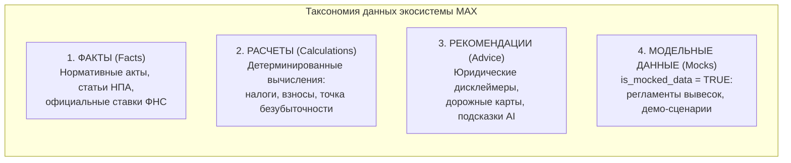
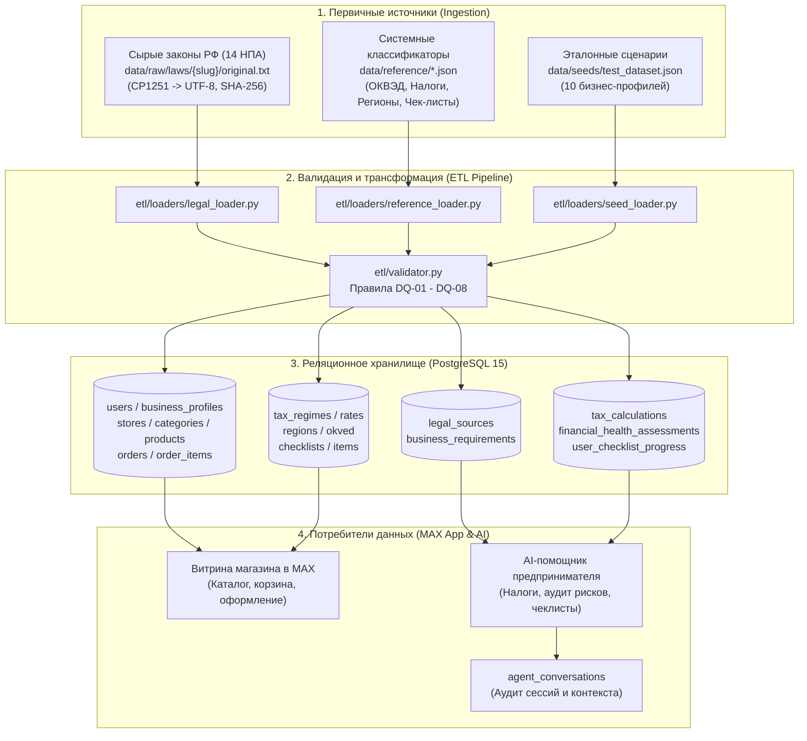

# Документация по данным (Data Documentation & Governance)

> **Проект:** «Конструктор бизнеса пользователя» в платформе MAX  
> **Версия:** 1.0.0 (Хакатон 2026, трек «Эффективный бизнес»)  
> **Статус:** Утверждено  
> **Связанные документы:**
> - [Требования к данным (DATA_REQUIREMENTS.md)](file:///d:/Hackaton/MAX/docs/DATA_REQUIREMENTS.md)
> - [Реляционная модель БД (DATABASE_MODEL.md)](file:///d:/Hackaton/MAX/docs/DATABASE_MODEL.md)
> - [Справочники и классификаторы (REFERENCE_DATA.md)](file:///d:/Hackaton/MAX/docs/REFERENCE_DATA.md)
> - [Нормативно-правовая база (LEGAL_CHECKLIST.md)](file:///d:/Hackaton/MAX/docs/LEGAL_CHECKLIST.md)
> - [Описание тестового датасета (TEST_DATA.md)](file:///d:/Hackaton/MAX/docs/TEST_DATA.md)
> - [Архитектура ETL-пайплайна (ETL_PIPELINE.md)](file:///d:/Hackaton/MAX/docs/ETL_PIPELINE.md)

---

## 1. Введение и концепция Data Governance

Настоящий документ представляет собой комплексное техническое и методологическое руководство по данным для сервиса **«Конструктор бизнеса пользователя»** и экосистемы AI-ассистентов в мессенджере MAX.

Цель документа — зафиксировать структуру хранения, источники происхождения, классификацию, правила контроля качества и порядок использования данных разработчиками, аналитиками данных и членами жюри хакатона.

### 1.1. Таксономия и классы данных

В строгом соответствии с требованиями кейса «Эффективный бизнес» все данные платформы классифицируются на 4 изолированные категории:



1. **Факты (Facts):**  
   Неизменяемые юридические первоисточники (14 федеральных законов и постановлений Правительства РФ, статьи НПА, верифицированные коды ОКВЭД 2, официальные ставки налогов).
2. **Расчеты (Calculations):**  
   Результаты математических моделей налоговой оптимизации (ст. 346.21 НК РФ, 422-ФЗ) и Unit-экономики. Все расчеты сопровождаются перечнем допущений (`assumptions`).
3. **Рекомендации (Recommendations):**  
   Сгенерированные аналитическим модулем и AI-агентами советы, предупреждения об ограничениях (например, порог годового дохода 2.4 млн руб. для самозанятых) и шаги дорожных карт.
4. **Моделированные / Синтетические данные (Mocked Data):**  
   Данные, имитирующие внешние ведомственные порталы (согласование вывесок в Комитете архитектуры, статус подачи заявлений в ФНС). Обязательно маркируются атрибутом `is_mocked_data = TRUE`.

---

## 2. Data Lineage (Происхождение и потоки данных)

Ниже представлена сквозная схема движения данных от сырых нормативно-правовых актов и пользовательского ввода через ETL-пайплайн до витрин и AI-диалогов в MAX:



---

## 3. Политика конфиденциальности и Zero PII (152-ФЗ)

> [!IMPORTANT]
> **Принцип Privacy by Design:**  
> В платформе реализован полный запрет на сбор, хранение и обработку избыточных персональных данных (ПДн).

### 3.1. Реестр категорий данных и статус обработки

| Категория информации | Статус в БД | Способ реализации / Обоснование |
|---|---|---|
| **Паспортные данные** (серия, номер, кем выдан) | ❌ **ЗАПРЕЩЕНО** | Полностью отсутствуют в схеме данных. Для самозанятых регистрация идет через официальное приложение «Мой налог» без передачи паспорта в MAX. |
| **Номера личных банковских карт** | ❌ **ЗАПРЕЩЕНО** | Отсутствуют. Расчеты происходят через платежный шлюз банка (СБП, эквайринг), в БД хранятся только статусы платежей. |
| **СНИЛС / Биометрия** | ❌ **ЗАПРЕЩЕНО** | Не используются в архитектуре. |
| **Идентификатор пользователя** | ✅ **РАЗРЕШЕНО** | Обезличенный строковый идентификатор `max_user_id` (например, `max_user_sweet_fox_01`), предоставляемый платформой MAX. |
| **ИНН организации / ИП** | ✅ **РАЗРЕШЕНО** | Открытые общедоступные сведения из ЕГРИП/ЕГРЮЛ согласно Федеральному закону № 129-ФЗ. Для самозанятых — значение `NULL`. |
| **Контактный телефон витрины** | ✅ **РАЗРЕШЕНО** | Публичный контакт магазина для связи покупателей (ст. 9 Закона РФ № 2300-1 «О защите прав потребителей»). |

---

## 4. Полный словарь данных (Data Dictionary & Catalog)

В реляционной модели данных реализовано **17 таблиц**, сгруппированных по 5 функциональным доменам. Ниже приведено исчерпывающее описание каждой таблицы и каждого атрибута.

---

### 4.1. Домен: Пользователи и бизнес-профили (Core Domain)

#### Таблица: `users`
Хранит учетные записи пользователей платформы MAX (продавцов и покупателей).
- **Первичный ключ:** `id` (UUID)
- **Уникальные ключи:** `max_user_id`

| Поле | Тип данных | Nullable | Значение по умолчанию | Описание и бизнес-смысл |
|---|---|---|---|---|
| `id` | `UUID` | ❌ No | `gen_random_uuid()` | Внутренний суррогатный первичный ключ записи. |
| `max_user_id` | `VARCHAR(64)` | ❌ No | — | Уникальный обезличенный идентификатор пользователя в экосистеме MAX. |
| `username` | `VARCHAR(64)` | ✔️ Yes | `NULL` | Никнейм пользователя в мессенджере MAX (без символа `@`). |
| `first_name` | `VARCHAR(64)` | ✔️ Yes | `NULL` | Имя пользователя для персонализации обращений бота. |
| `last_name` | `VARCHAR(64)` | ✔️ Yes | `NULL` | Фамилия пользователя. |
| `avatar_url` | `VARCHAR(512)`| ✔️ Yes | `NULL` | URL аватара профиля в CDN MAX. |
| `created_at` | `TIMESTAMPTZ` | ❌ No | `NOW()` | Дата и время создания учетной записи в БД. |
| `updated_at` | `TIMESTAMPTZ` | ❌ No | `NOW()` | Дата и время последнего изменения (обновляется триггером). |

---

#### Таблица: `business_profiles`
Карточка субъекта предпринимательской деятельности (ИП, Самозанятый, ООО).
- **Первичный ключ:** `id` (UUID)
- **Внешние ключи:**  
  - `user_id` $\rightarrow$ `users(id)` (ON DELETE CASCADE)  
  - `legal_form` $\rightarrow$ `legal_forms(code)`  
  - `okved_code` $\rightarrow$ `okved(code)`  
  - `region_code` $\rightarrow$ `regions(code)`  
  - `tax_regime_code` $\rightarrow$ `tax_regimes(code)`

| Поле | Тип данных | Nullable | Ограничения (Check) | Описание и бизнес-смысл |
|---|---|---|---|---|
| `id` | `UUID` | ❌ No | PK | Уникальный идентификатор бизнеса. |
| `user_id` | `UUID` | ❌ No | FK | Владелец бизнеса (пользователь MAX). |
| `legal_form` | `VARCHAR(32)` | ❌ No | `self_employed`, `ip`, `ooo` | Организационно-правовая форма. |
| `business_name`| `VARCHAR(255)`| ❌ No | — | Коммерческое наименование (например: *Кондитерская «Сладкий Лис»*). |
| `inn` | `VARCHAR(12)` | ✔️ Yes | DQ-04: 10/12 цифр | ИНН (10 цифр для ООО, 12 для ИП, NULL для самозанятых). |
| `ogrn_ogrnip` | `VARCHAR(15)` | ✔️ Yes | 13/15 цифр | ОГРН юрлица (13 цифр) или ОГРНИП предпринимателя (15 цифр). |
| `okved_code` | `VARCHAR(16)` | ❌ No | FK | Основной код вида экономической деятельности (ОКВЭД 2). |
| `region_code` | `VARCHAR(10)` | ❌ No | FK | Код субъекта РФ по Конституции (77 — Москва, 16 — Татарстан и т.д.). |
| `city` | `VARCHAR(128)`| ❌ No | — | Город фактического ведения бизнеса (для расчета региональных выверок). |
| `tax_regime_code`| `VARCHAR(32)`| ❌ No | FK | Применяемая система налогообложения (НПД, УСН, АУСН). |
| `has_employees`| `BOOLEAN` | ❌ No | Default `FALSE` | Флаг наличия наемных работников по трудовому договору. |
| `employee_count`| `INTEGER` | ❌ No | Default `0`, $\ge 0$ | Количество официально трудоустроенных сотрудников. |
| `monthly_revenue_est`| `NUMERIC(14,2)`| ❌ No | $\ge 0.00$ | Прогнозируемая или фактическая среднемесячная выручка (руб.). |
| `monthly_expenses_est`| `NUMERIC(14,2)`| ❌ No | $\ge 0.00$ | Среднемесячные операционные расходы бизнеса (руб.). |
| `status` | `VARCHAR(32)` | ❌ No | `draft`, `active`, `suspended`, `closed` | Текущий жизненный статус карточки бизнеса. |
| `created_at` | `TIMESTAMPTZ` | ❌ No | `NOW()` | Время регистрации профиля. |
| `updated_at` | `TIMESTAMPTZ` | ❌ No | `NOW()` | Время последнего обновления (триггер). |

> [!NOTE]
> **Ограничение уровня БД (CHECK):**  
> `CONSTRAINT chk_npd_revenue CHECK (legal_form != 'self_employed' OR (monthly_revenue_est * 12 <= 2400000))` — гарантирует невозможность сохранения в БД самозанятого с доходом, превышающим лимит ст. 4 422-ФЗ.  
> `CONSTRAINT chk_npd_no_employees CHECK (legal_form != 'self_employed' OR (has_employees = FALSE AND employee_count = 0))` — запрет наемных сотрудников для НПД.

---

### 4.2. Домен: Электронная коммерция и витрины в MAX (Commerce Domain)

#### Таблица: `stores`
Витрина интернет-магазина, функционирующая внутри мессенджера MAX.
- **Первичный ключ:** `id` (UUID)
- **Уникальные ключи:** `slug` (буквенно-цифровой идентификатор в URL витрины)
- **Внешние ключи:** `business_profile_id` $\rightarrow$ `business_profiles(id)` (ON DELETE CASCADE)

| Поле | Тип данных | Nullable | Значение по умолчанию | Описание и бизнес-смысл |
|---|---|---|---|---|
| `id` | `UUID` | ❌ No | `gen_random_uuid()` | Идентификатор витрины. |
| `business_profile_id` | `UUID` | ❌ No | — | Связанный профиль бизнеса. |
| `slug` | `VARCHAR(128)`| ❌ No | — | Уникальный URL-идентификатор магазина в MAX (например: `sweet_fox_bakery`). |
| `title` | `VARCHAR(255)`| ❌ No | — | Публичное название витрины, отображаемое покупателю. |
| `description` | `TEXT` | ✔️ Yes | `NULL` | Описание магазина, концепция, режим работы, ссылка на политику 152-ФЗ. |
| `banner_url` | `VARCHAR(512)`| ✔️ Yes | `NULL` | Баннер шапки витрины. |
| `logo_url` | `VARCHAR(512)`| ✔️ Yes | `NULL` | Логотип витрины (иконка в каталоге MAX). |
| `contact_phone` | `VARCHAR(32)` | ✔️ Yes | `NULL` | Контактный номер телефона для поддержки покупателей. |
| `pickup_address`| `TEXT` | ✔️ Yes | `NULL` | Адрес точки самовывоза (при наличии). |
| `delivery_enabled`| `BOOLEAN` | ❌ No | `FALSE` | Доступна ли курьерская доставка заказов. |
| `delivery_terms`| `TEXT` | ✔️ Yes | `NULL` | Условия и зоны доставки по городу. |
| `delivery_min_amount`| `NUMERIC(12,2)`| ❌ No | `0.00` | Минимальная сумма заказа для оформления доставки (руб.). |
| `delivery_fee` | `NUMERIC(12,2)`| ❌ No | `0.00` | Фиксированная стоимость доставки (руб.). |
| `is_published` | `BOOLEAN` | ❌ No | `FALSE` | Флаг видимости витрины в каталоге мессенджера MAX. |
| `created_at` | `TIMESTAMPTZ` | ❌ No | `NOW()` | Дата создания. |
| `updated_at` | `TIMESTAMPTZ` | ❌ No | `NOW()` | Дата обновления. |

---

#### Таблица: `product_categories`
Рубрикатор каталога товаров конкретного магазина.
- **Первичный ключ:** `id` (`BIGSERIAL`)
- **Внешние ключи:** `store_id` $\rightarrow$ `stores(id)` (ON DELETE CASCADE)

| Поле | Тип данных | Nullable | Описание и бизнес-смысл |
|---|---|---|---|
| `id` | `BIGSERIAL` | ❌ No | Первичный ключ категории. |
| `store_id` | `UUID` | ❌ No | Магазин, которому принадлежит категория. |
| `name` | `VARCHAR(128)` | ❌ No | Название категории (например: *«Бенто-торты»*, *«Худи и свитшоты»*). |
| `sort_order` | `INTEGER` | ❌ No | Порядок отображения в меню витрины (по возрастанию). |
| `created_at` | `TIMESTAMPTZ` | ❌ No | Время добавления категории. |

---

#### Таблица: `products`
Номенклатурная позиция каталога: готовый товар или оказываемая услуга.
- **Первичный ключ:** `id` (UUID)
- **Внешние ключи:**  
  - `store_id` $\rightarrow$ `stores(id)` (ON DELETE CASCADE)  
  - `category_id` $\rightarrow$ `product_categories(id)` (ON DELETE SET NULL)

| Поле | Тип данных | Nullable | Ограничения | Описание и бизнес-смысл |
|---|---|---|---|---|
| `id` | `UUID` | ❌ No | PK | Идентификатор товара/услуги. |
| `store_id` | `UUID` | ❌ No | FK | Витрина магазина в MAX. |
| `category_id` | `BIGINT` | ✔️ Yes | FK | Категория каталога. |
| `type` | `VARCHAR(16)` | ❌ No | `good`, `service` | Тип позиции: `good` (материальный товар) или `service` (услуга/работа). |
| `name` | `VARCHAR(255)`| ❌ No | — | Наименование товара/услуги. |
| `description` | `TEXT` | ✔️ Yes | — | Подробное описание, состав, характеристики, условия возврата. |
| `price` | `NUMERIC(12,2)`| ❌ No | $\ge 0.00$ | Розничная цена в рублях. |
| `currency` | `VARCHAR(3)` | ❌ No | Default `'RUB'` | Валюта расчетов (ISO 4217). |
| `unit` | `VARCHAR(32)` | ❌ No | Default `'шт'` | Единица измерения (`шт`, `кг`, `порция`, `урок`, `проект`). |
| `image_url` | `VARCHAR(512)`| ✔️ Yes | — | URL фотографии товара в каталоге. |
| `is_in_stock` | `BOOLEAN` | ❌ No | Default `TRUE` | Доступность для заказа покупателями. |
| `stock_quantity`| `INTEGER` | ❌ No | Default `0`, $\ge 0$ | Доступный складской остаток (для материальных товаров). |
| `requires_marking`| `BOOLEAN` | ❌ No | Default `FALSE` | **Признак обязательной маркировки «Честный ЗНАК»** (Data Matrix код). |
| `status` | `VARCHAR(16)` | ❌ No | `active`, `archived` | Статус карточки товара в каталоге. |
| `created_at` | `TIMESTAMPTZ` | ❌ No | `NOW()` | Дата создания карточки. |
| `updated_at` | `TIMESTAMPTZ` | ❌ No | `NOW()` | Дата изменения (триггер). |

---

#### Таблица: `orders`
Заказы, оформленные покупателями через чат-бота или витрину MAX.
- **Первичный ключ:** `id` (UUID)
- **Уникальные ключи:** `order_number`
- **Внешние ключи:** `store_id` $\rightarrow$ `stores(id)` (ON DELETE CASCADE)

| Поле | Тип данных | Nullable | Описание и бизнес-смысл |
|---|---|---|---|
| `id` | `UUID` | ❌ No | Идентификатор заказа. |
| `store_id` | `UUID` | ❌ No | Магазин-продавец. |
| `order_number` | `VARCHAR(64)` | ❌ No | Человекочитаемый номер заказа (например: `ORD-2026-0001`). |
| `customer_max_user_id`| `VARCHAR(64)`| ❌ No | Обезличенный идентификатор покупателя в MAX. |
| `customer_name` | `VARCHAR(128)`| ❌ No | Имя покупателя для обращения курьера. |
| `customer_phone` | `VARCHAR(32)` | ❌ No | Телефон для согласования доставки. |
| `delivery_type` | `VARCHAR(16)` | ❌ No | `pickup` (самовывоз) или `delivery` (курьерская доставка). |
| `delivery_address` | `TEXT` | ✔️ Yes | Адрес доставки (обязателен при `delivery_type = 'delivery'`). |
| `total_amount` | `NUMERIC(14,2)`| ❌ No | Итоговая сумма заказа с учетом доставки (руб.). |
| `currency` | `VARCHAR(3)` | ❌ No | Валюта (`RUB`). |
| `status` | `VARCHAR(32)` | ❌ No | `new`, `confirmed`, `paid`, `in_delivery`, `completed`, `cancelled`. |
| `customer_comment` | `TEXT` | ✔️ Yes | Комментарий к заказу или пожелания по доставке. |
| `created_at` | `TIMESTAMPTZ` | ❌ No | Дата и время оформления. |
| `updated_at` | `TIMESTAMPTZ` | ❌ No | Дата смены статуса заказа. |

---

#### Таблица: `order_items`
Состав заказа (строки чека) с неизменяемыми историческими снимками цен.
- **Первичный ключ:** `id` (`BIGSERIAL`)
- **Внешние ключи:**  
  - `order_id` $\rightarrow$ `orders(id)` (ON DELETE CASCADE)  
  - `product_id` $\rightarrow$ `products(id)` (ON DELETE SET NULL)

| Поле | Тип данных | Nullable | Описание и бизнес-смысл |
|---|---|---|---|
| `id` | `BIGSERIAL` | ❌ No | Первичный ключ позиции. |
| `order_id` | `UUID` | ❌ No | Связанный заказ. |
| `product_id` | `UUID` | ✔️ Yes | Ссылка на товар (при удалении товара из каталога сохраняется `NULL`). |
| `product_name_snapshot`| `VARCHAR(255)`| ❌ No | Зафиксированное историческое название товара на момент покупки. |
| `unit_price_snapshot` | `NUMERIC(12,2)`| ❌ No | Зафиксированная цена единицы товара на момент покупки (руб.). |
| `quantity` | `INTEGER` | ❌ No | Количество единиц ($\ge 1$). |
| `total_price` | `NUMERIC(12,2)`| ❌ No | Итоговая стоимость позиции (`unit_price * quantity`). |
| `created_at` | `TIMESTAMPTZ` | ❌ No | Дата добавления. |

---

### 4.3. Домен: Нормативно-правовая база и требования (Legal Domain)

#### Таблица: `legal_sources`
Реестр официальных первоисточников нормативно-правовых актов РФ.
- **Первичный ключ:** `id` (`VARCHAR(64)`, slug НПА, например: `fz_422_npd`)

| Поле | Тип данных | Nullable | Описание и бизнес-смысл |
|---|---|---|---|
| `id` | `VARCHAR(64)` | ❌ No | Уникальный буквенный код закона (slug). |
| `official_number` | `VARCHAR(64)` | ❌ No | Официальный номер акта (например: `422-ФЗ`, `НК РФ Гл. 26.2`, `54-ФЗ`). |
| `full_title` | `TEXT` | ❌ No | Полное официальное наименование правового акта. |
| `publisher_authority`| `VARCHAR(255)`| ❌ No | Орган, издавший акт (ФНС России, Минфин РФ, Роспотребнадзор). |
| `official_url` | `VARCHAR(512)`| ❌ No | Официальная ссылка на публикацию (`pravo.gov.ru`, `nalog.gov.ru`). |
| `source_type` | `VARCHAR(32)` | ❌ No | `federal_law`, `code_rf`, `gov_decree`, `municipal_act`, `decree`. |
| `effective_date` | `DATE` | ❌ No | Дата вступления в силу актуальной редакции документа. |
| `checksum_sha256` | `VARCHAR(64)` | ❌ No | Контрольная сумма SHA-256 файла закона для аудита неизменяемости. |
| `created_at` | `TIMESTAMPTZ` | ❌ No | Время внесения в базу. |
| `updated_at` | `TIMESTAMPTZ` | ❌ No | Время обновления редакции. |

---

#### Таблица: `business_requirements`
Атомарные юридические требования к бизнесу, извлеченные из НПА.
- **Первичный ключ:** `id` (`BIGSERIAL`)
- **Внешние ключи:** `source_id` $\rightarrow$ `legal_sources(id)` (ON DELETE CASCADE)

| Поле | Тип данных | Nullable | Описание и бизнес-смысл |
|---|---|---|---|
| `id` | `BIGSERIAL` | ❌ No | Первичный ключ требования. |
| `source_id` | `VARCHAR(64)` | ❌ No | Ссылка на нормативный акт. |
| `category` | `VARCHAR(32)` | ❌ No | `registration`, `taxes`, `kkt_receipts`, `signboards`, `personal_data`, `labeling`, `sanitary`. |
| `title` | `VARCHAR(255)` | ❌ No | Краткий заголовок требования для вывода в UI бота. |
| `summary` | `TEXT` | ❌ No | Суть требования простым языком для предпринимателя. |
| `legal_citation` | `TEXT` | ❌ No | Точная цитата статьи НПА с пунктом и частью. |
| `applies_to_legal_forms`| `TEXT[]` | ❌ No | Массив правовых форм, к которым применяется: `{'self_employed', 'ip', 'ooo'}`. |
| `applies_to_okved_prefixes`| `TEXT[]`| ✔️ Yes | Префиксы кодов ОКВЭД (например: `{'47.', '56.'}`), для всех — `NULL`. |
| `region_code` | `VARCHAR(10)` | ✔️ Yes | Код региона для местных норм (для федеральных — `NULL`). |
| `is_mandatory` | `BOOLEAN` | ❌ No | Обязательность соблюдения (штрафной риск). |
| `penalty_risk_description`| `TEXT` | ✔️ Yes | Размер административных штрафов по КоАП РФ или санкций ФНС. |
| `action_plan` | `JSONB` | ❌ No | Пошаговый алгоритм выполнения требования (`steps`, `links`, `time_est`). |
| `is_simulated_in_mvp` | `BOOLEAN` | ❌ No | Флаг демонстрационной модели в рамках MVP хакатона. |
| `created_at` | `TIMESTAMPTZ` | ❌ No | Дата добавления. |
| `updated_at` | `TIMESTAMPTZ` | ❌ No | Дата обновления. |

---

### 4.4. Домен: Аналитика, расчеты и AI-оценки (Analytics Domain)

#### Таблица: `tax_calculations`
История и детальные результаты моделирования налоговой нагрузки.
- **Первичный ключ:** `id` (UUID)
- **Внешние ключи:**  
  - `business_profile_id` $\rightarrow$ `business_profiles(id)` (ON DELETE CASCADE)  
  - `recommended_regime_code` $\rightarrow$ `tax_regimes(code)`

| Поле | Тип данных | Nullable | Описание и бизнес-смысл |
|---|---|---|---|
| `id` | `UUID` | ❌ No | Первичный ключ расчета. |
| `business_profile_id` | `UUID` | ❌ No | Профиль бизнеса, для которого выполнен расчет. |
| `input_parameters` | `JSONB` | ❌ No | Исходные параметры: выручка, расходы, наличие сотрудников, ФОТ, регион. |
| `results_comparison`| `JSONB` | ❌ No | Сравнение всех применимых режимов (НПД vs УСН «Доходы» vs УСН «Д-Р»). |
| `recommended_regime_code`| `VARCHAR(32)`| ❌ No | Код математически оптимального налогового режима. |
| `estimated_annual_tax`| `NUMERIC(14,2)`| ❌ No | Прогнозируемая сумма налога за год (руб.). |
| `estimated_annual_insurance`| `NUMERIC(14,2)`| ❌ No | Фиксированные страховые взносы ИП за 2026 год (53 658 руб. по ст. 430 НК РФ). |
| `assumptions` | `TEXT[]` | ❌ No | Массив допущений и юридических оговорок к расчету. |
| `created_at` | `TIMESTAMPTZ` | ❌ No | Время выполнения расчета. |

---

#### Таблица: `financial_health_assessments`
Комплексная оценка жизнеспособности и риска кассового разрыва (Unit-экономика).
- **Первичный ключ:** `id` (UUID)
- **Внешние ключи:**  
  - `business_profile_id` $\rightarrow$ `business_profiles(id)` (ON DELETE CASCADE)  
  - `tax_calculation_id` $\rightarrow$ `tax_calculations(id)` (ON DELETE SET NULL)

| Поле | Тип данных | Nullable | Ограничения | Описание и бизнес-смысл |
|---|---|---|---|---|
| `id` | `UUID` | ❌ No | PK | Первичный ключ оценки. |
| `business_profile_id` | `UUID` | ❌ No | FK | Бизнес-профиль. |
| `tax_calculation_id` | `UUID` | ✔️ Yes | FK | Ссылка на связанный налоговый расчет. |
| `monthly_revenue` | `NUMERIC(14,2)`| ❌ No | $\ge 0$ | Ежемесячная выручка (руб.). |
| `monthly_fixed_costs`| `NUMERIC(14,2)`| ❌ No | $\ge 0$ | Постоянные затраты (аренда, связь, оклады). |
| `monthly_variable_costs`| `NUMERIC(14,2)`| ❌ No | $\ge 0$ | Переменные затраты (закупка, сырье, эквайринг). |
| `net_monthly_profit`| `NUMERIC(14,2)`| ❌ No | — | Чистая прибыль в месяц за вычетом расходов и налога. |
| `margin_percent` | `NUMERIC(5,2)` | ❌ No | — | Рентабельность / маржинальность по чистой прибыли (%). |
| `break_even_point` | `NUMERIC(14,2)`| ❌ No | — | **Точка безубыточности** (минимальная выручка для работы в 0). |
| `safety_margin_percent`| `NUMERIC(5,2)`| ❌ No | — | **Запас финансовой прочности (%)**: удаленность от безубыточности. |
| `cash_gap_risk_level`| `VARCHAR(16)` | ❌ No | `LOW`, `MEDIUM`, `HIGH` | Степень риска кассового разрыва. |
| `verdict` | `VARCHAR(32)` | ❌ No | `SUSTAINABLE`, `AT_RISK`, `CRITICAL` | Итоговый вердикт устойчивости бизнеса. |
| `recommendations` | `JSONB` | ❌ No | — | Список конкретных мер по оптимизации расходов и росту выручки. |
| `created_at` | `TIMESTAMPTZ` | ❌ No | `NOW()` | Дата формирования оценки. |

---

### 4.5. Домен: Нормативно-справочная информация (Reference Domain)

| Таблица | Первичный ключ | Описание сущности |
|---|---|---|
| `legal_forms` | `code VARCHAR(32)` | Справочник организационно-правовых форм: `self_employed` (НПД), `ip` (ИП), `ooo` (ООО). |
| `tax_regimes` | `code VARCHAR(32)` | Системы налогообложения 2026 г.: `npd`, `usn_income`, `usn_income_expense`, `ausn_income`, `ausn_income_expense`, `psn`, `osno`. |
| `tax_regional_rates` | `id BIGSERIAL` | Региональные ставки налогов (Татарстан 7%, Свердловская обл. 7%, Москва 10%, базовая 15%). |
| `regions` | `code VARCHAR(10)` | Субъекты Российской Федерации (код, наименование, федеральный округ). |
| `okved` | `code VARCHAR(16)` | Коды видов экономической деятельности ОКВЭД 2 с флагами обязательной маркировки. |
| `signboard_regulations` | `id BIGSERIAL` | Регламенты размещения информационных вывесок (высота, ширина, согласования, `is_mocked_data=TRUE`). |
| `checklists` | `id BIGSERIAL` | Дорожные карты открытия бизнеса по правовым формам (НПД, ИП, ООО). |
| `checklist_items` | `id BIGSERIAL` | Атомарные задачи чек-листа с сортировкой и ссылкой на требование закона. |
| `user_checklist_progress`| `id BIGSERIAL` | Индивидуальный прогресс выполнения чек-листа конкретным бизнесом в MAX. |
| `agent_conversations` | `id UUID` | История обращений к AI-ассистентам платформы MAX для аудита и контекста диалогов. |

---

## 5. Матрица контроля качества данных (Data Quality Rules)

Для предотвращения деградации качества данных и исключения человеческих ошибок в пайплайне и на уровне БД реализованы строгие правила валидации:

| Код правила | Наименование | Уровень проверки | Описание и логика | Реакция системы |
|---|---|---|---|---|
| **DQ-01** | Превышение лимита НПД | Python + DB CHECK | `monthly_revenue_est * 12 <= 2400000` для `legal_form = 'self_employed'` (ст. 4 422-ФЗ). | Запрет сохранения самозанятого с доходом > 2.4 млн руб. Выдача ошибки валидатора. |
| **DQ-02** | Запрет сотрудников на НПД | Python + DB CHECK | `has_employees = FALSE` и `employee_count = 0` для `legal_form = 'self_employed'`. | Отклонение записи при попытке привязать сотрудников к самозанятому. |
| **DQ-03** | Неотрицательность финансов | Python + DB CHECK | `monthly_revenue_est >= 0`, `monthly_expenses_est >= 0`, `price >= 0`, `stock_quantity >= 0`. | Блокировка отрицательных сумм в карточках и ценах каталога. |
| **DQ-04** | Валидация формата ИНН | Python Regex | ООО: ровно 10 цифр; ИП: ровно 12 цифр; Самозанятый: допускается `NULL`. | Запись помечается невалидной с логированием в `WARN`. |
| **DQ-05** | Корректность субъекта РФ | Python + DB FK | `region_code` обязан существовать в таблице `regions` (20 основных регионов). | Блокировка сохранения профиля с несуществующим кодом региона. |
| **DQ-06** | Контроль маркировки товаров | Python Validator | Если ОКВЭД 47.71 (одежда) или 47.72 (обувь) $\rightarrow$ товар обязан иметь `requires_marking = TRUE`. | Автоматическое выставление флага маркировки и предупреждение продавца в UI. |
| **DQ-07** | Идемпотентность загрузки | DB Upsert | Все `INSERT` содержат секцию `ON CONFLICT (...) DO UPDATE`. | Повторный запуск ETL не приводит к дублированию строк в БД. |
| **DQ-08** | Целостность внешних связей | DB Foreign Keys | Все внешние связи защищены декларативными FK (`CASCADE` для зависимых, `SET NULL` для ссылочных). | Исключение появления «зависших» заказов и товаров при удалении витрины. |

---

## 6. Жизненный цикл данных и аудит (Data Lifecycle & Audit)

### 6.1. Автоматический аудит изменений (`updated_at`)
Во всех изменяемых таблицах функционирует единая триггерная функция PostgreSQL:
```sql
CREATE OR REPLACE FUNCTION update_updated_at_column()
RETURNS TRIGGER AS $$
BEGIN
    NEW.updated_at = NOW();
    RETURN NEW;
END;
$$ LANGUAGE plpgsql;
```
Это гарантирует, что дата изменения записи обновляется на уровне СУБД независимо от клиентского приложения.

### 6.2. Каскадность и сохранение историчности
- **Удаление витрины (`stores`):** Приводит к каскадному удалению связанных товаров и категорий (`ON DELETE CASCADE`), так как они не могут существовать без магазина.
- **Удаление товара (`products`):** Не разрушает исторические данные совершенных заказов (`ON DELETE SET NULL` в `order_items`), а зафиксированные снимки цен и названий (`product_name_snapshot`, `unit_price_snapshot`) сохраняются неизменными.

---

## 7. Руководство потребителя данных (Data Consumer Guide)

### Пример 1: Поиск оптимального налогового режима по профилю бизнеса
```sql
SELECT 
    bp.business_name,
    bp.legal_form,
    tc.recommended_regime_code AS optimal_regime,
    tc.estimated_annual_tax AS min_tax_rub,
    tc.assumptions[1] AS primary_disclaimer
FROM business_profiles bp
JOIN tax_calculations tc ON tc.business_profile_id = bp.id
WHERE bp.status = 'active';
```

### Пример 2: Выгрузка каталога витрины с контролем маркировки «Честный ЗНАК»
```sql
SELECT 
    s.title AS store_name,
    pc.name AS category_name,
    p.name AS product_title,
    p.price,
    p.unit,
    p.requires_marking,
    p.is_in_stock
FROM products p
JOIN stores s ON p.store_id = s.id
LEFT JOIN product_categories pc ON p.category_id = pc.id
WHERE s.slug = 'sever_clothing' AND p.status = 'active'
ORDER BY pc.sort_order, p.price DESC;
```

### Пример 3: Аудит устойчивости бизнеса и риска кассового разрыва
```sql
SELECT 
    bp.business_name,
    fha.monthly_revenue,
    fha.break_even_point,
    fha.safety_margin_percent,
    fha.cash_gap_risk_level,
    fha.verdict,
    fha.recommendations->0 AS urgent_recommendation
FROM financial_health_assessments fha
JOIN business_profiles bp ON fha.business_profile_id = bp.id
WHERE fha.verdict IN ('AT_RISK', 'CRITICAL');
```
